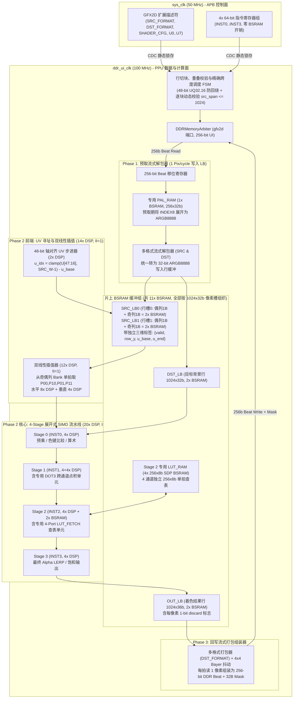

# AE350 GFX2D 可编程像素着色器核心（GFX2D-PPU）架构设计规格

> 适用机器：`mega138k_ae350`（Tang Mega 138K Pro / Gowin GW5AST-LV138FPG676A）。
> 状态：**二期 Step 6a（基础架构、行缓冲、Stage 0..1 及 DOT3）、Step 6b（完整 4-Stage、`PAL_RAM`、4 通道 `LUT_RAM`）、Step 6c（48-bit UV 缩放、逐块跨度门禁、`SRC_LB0/1` 双行槽与双线性插值）与 Step 6d（BSP `ae350_gfx2d_blend` / `ae350_gfx2d_scale` 及 Linux `fbdev` / `DRM` 接入）已完成**。
> 关联文档：[GFX2D 一期规格与实机验收](gfx2d.md)、[GW5AST 硬核资源说明](gw5ast-hard-ip-usage.md)、[地址映射合同](address-map.md)。

---

## 1. 设计背景与定位

在一期（Phase 1，Step 1–5b）中，[`Gfx2DEngine`](../../../gateware/machines/mega138k_ae350/peripherals/gfx2d.py) 已完成固定功能 2D 块加速（`FILL_RECT`、`COPY_AREA`、`IMAGE_BLIT`）并打通 BIOS TTY、Linux `fbdev` 与 `DRM` 全链路。

根据板级全量 PnR 实测报告（Run `7738ba`），GW5AST-138B 的片上硬核计算与存储资源充裕，其中 **DSP 乘法累加器与 BSRAM 块存储剩余量大**：

| 片上资源类型 | 已用资源 (Run `7738ba`) | 芯片总量 (GW5AST-138B) | 剩余可用量 | 当前利用率 |
| :--- | ---: | ---: | ---: | ---: |
| **逻辑单元 (LUT + ALU)** | 46,932 | 138,240 | **91,308** | 34% |
| **寄存器 (FF)** | 43,039 | 139,140 | **96,101** | 31% |
| **块存储 (BSRAM 18Kbit)** | 135 | 340 | **205** | 40% |
| **硬核 DSP (MULT27X18 / ALU54D)** | 23.5 | 298 | **274.5** | **8%** |

### 1.1 核心设计目标与边界闭合原则
为确保设计可直接作为 RTL 落地规格，本规范严格闭合 **ISA 编码、定点与归一化数值语义、源/目标双格式 ABI、48-bit 防回绕 UV 坐标运算、逐块跨度与重叠安全调度** 核心硬件合同：

1. **硬件固定操作零退化**：`OP=0/1/2`（`FILL_RECT` / `COPY_AREA` / `IMAGE_BLIT`）继续保持原有 256-bit（32 字节）单拍直通状态机，不经过逐像素解包。
2. **直通式 4 级流水可编程像素核心（`OP_SHADER = 3`）**：
   - 采用**无回环、固定 4 级串联展开（4-Stage Feed-Forward Pipeline）**架构：每个 Stage 包含 4 个通道（`.a, .r, .g, .b`）的独立 DSP 算术单元与 LUT 逻辑。
   - **取消长程序多趟回环（No Loop-back）**：将着色器长度严格固定为 `1..4` 条 VLIW 微指令。这彻底消除了多趟回环带来的每像素上下文暂存 RAM、流水线排空/重填控制气泡与反压死锁风险，确保着色流水线在计算阶段填满后**恒定以 `II=1`（1 像素/时钟周期 @ 100MHz `ddr_ui_clk`）流式推进**。
3. **纹理重采样边界限定为轴对齐缩放（Axis-Aligned Scale）**：
   - 二期行缓冲架构仅支持**轴对齐 2D 缩放（StretchBlit / Scale，$dU_y = 0, dV_x = 0$）**，包括最近邻（Nearest）与双线性（Bilinear）过滤。
   - **任意角度旋转（$dV_x \neq 0$）列为二期非目标**：因旋转时同一目标行会跨越任意多条源扫描线，纯行缓冲无法避免随机跨行 DDR 突发读与缓存缺失停顿；旋转操作需未来配合独立 2D Block Tile Cache 立项。
4. **专用执行单元跨级解耦**：
   - 将跨通道点积单元（`DOT3`）固定分配在 **Stage 1**，将 4 通道并行查找表（`LUT_FETCH`）固定分配在 **Stage 2**，将前端 `INDEX8` 调色板展开分配在独立的 **预取解包专用 `PAL_RAM`** 中，使“预取 `INDEX8` 解包 → 双线性插值 → Stage 1 `DOT3` 灰度化 → Stage 2 `LUT_FETCH` 色调映射 → Stage 3 `LERP` 混合”可在单趟流水内以 `II=1` 无冲突完成。

---

## 2. GW5AST-138B DSP 与 BSRAM 硬件原语映射预算与实测对比

> [!IMPORTANT]
> - **Step 6a（已实测闭合）**：包含行缓冲（`SRC_LB0`、`DST_LB`、`OUT_LB`）、流式解包/打包器、Stage 0..1 核心与 Stage 1 `DOT3` 点积单元。在 Gowin 全量 PnR（Run `20261111T175107778773Z` / Commit `d6d7cfe`）中**实测增量为 +8 BSRAM（整机 143/340，43%）与 +4 DSP（整机 27.5/298，10%）**，`ddr_ui_clk` 100MHz 保持 **0 TNS** 建立/保持全时钟时序闭合，且已完成实机板载 SRAM 验收（Run `20261111T191108626301Z`，7 阶段全部通过）。
> - **Step 6b（已实测闭合）**：Stage 2..3、`PAL_RAM` 与 4×`256×8` `LUT_RAM`。全量 PnR（Run `20261113T010649048418Z`）相对 Step 6a **实测增量为 +20 DSP（整机 47.5/298，16%）与 +44 BSRAM（整机 187/340，55%）**；BSRAM 增量同时包含 DDR3 读/请求 FIFO 改用 `block_ram`（避免 LUT RAM 在 100MHz 下的时序问题）。全部时钟 setup/hold **0 TNS**（`ddr_ui_clk` 100.04MHz，`sys_clk` 50.16MHz），时序收敛全部来自 RTL 结构修改，未调整 PnR seed/选项。实机 SRAM 验收（Run `20261113T014213929850Z` 上传，`20261113T014251800531Z` JTAG 读回）结果字 `0xC3500020`，全部 BAD 计数为 0。
> - **Step 6c（已实测闭合）**：48-bit `UQ32.16` UV 步进与 Clamp、步长选档与 `TILE_SETUP` 逐块跨度门禁、`SRC_LB0/1` 奇偶行 × 奇偶列双 Bank 与行槽标签、12 乘法器双线性前端（`OP_SCALE_BLIT`）。全量 PnR（Run `20261113T192338423908Z`）相对 Step 6b **实测增量为 +11 DSP（整机 58.5/298，20%）与 +4 BSRAM（整机 191/340，57%）**，逻辑 CLS 82%（56483/69120）。全部时钟 setup/hold **0 TNS**（`ddr_ui_clk` 100.00MHz，`sys_clk` 50.10MHz，`hdmi_pix_clk` 75.95MHz）。时序收敛来自 RTL 结构修改（`DST_LB`/`OUT_LB` 读写寄存、描述符校验与 V 几何分级寄存、宽计数器增量预寄存、仲裁器 one-hot 负载选择、fabric 逐页 valid 寄存与 DDR 诊断页私有地址副本等），未调整 PnR seed/选项；曾尝试的 GFX2D 区域布局约束因 21857 条网络无法布通而放弃。实机 SRAM 验收（Run `20261113T200126914932Z` 上传，`20261113T200202540377Z` JTAG 读回）结果字 `0xC3500030`，全部 BAD 计数为 0（含 `W_tile=1022` 跨度反例与 `U0=0xFFFF0000` 不回绕用例）。

| 子模块 | 阶段归属 | 目标 DSP 预算 | 目标 BSRAM (18Kb) | Step 6a/6b 实测增量 | 硬件映射与端口配置说明 |
| :--- | :---: | :---: | :---: | :---: | :--- |
| **1. 48-bit 轴对齐 UV 步进与寻址 (AGU)** | Step 6c | **2 DSP** | 0 | 已实现（计入 6c 整机 **+11 DSP**） | 采用 48-bit `UQ32.16` 无回绕精度计算 $V_{\text{row}}$ 与 $U_{\text{first}}$；行内纯加法累加；`TILE_SETUP` 跨度与源行地址各拆 2 个寄存乘法；纹理范围另用 1 个 14×16 高半积乘法判定 32-bit 截断 |
| **2. 双线性 2×2 插值前端 (Bilinear)** | Step 6c | **12 DSP** | 0 | 已实现（计入 6c 整机 **+11 DSP**） | 每通道水平 2 + 垂直 1 个 `9×9` 有符号乘法，共 12 个乘法器，6 拍流水维持 `II=1` |
| **3. 4-Stage × 4-Channel SIMD 着色阵列** | Step 6a/6b | **16 DSP** | 0 | 6a **+0 DSP**；6b 整机 **+20 DSP** | Step 6a 落地 Stage 0..1；Step 6b 补齐 Stage 2..3（乘法由综合映射到硬核 DSP） |
| **4. 专用色度点积辅助单元 (Stage 1 DOT3)**| Step 6a | **4 DSP** | 0 | **+4 DSP** (MULTALU27X18) | 供 **Stage 1** 执行 `DOT3` 跨通道并行乘加运算（实测占用 4 个硬核 DSP） |
| **5. 源图像奇偶行与奇偶列缓存 (`SRC_LB0/1`)** | Step 6a/6c | 0 | **4 BSRAM** | 6a **+2 BSRAM**；6c 整机 **+4 BSRAM** | Step 6a 落地 `SRC_LB0`（2×BSRAM，1024×32b）；Step 6c 补齐 `SRC_LB1` 双行槽，每槽拆为偶/奇列 2 个 Bank |
| **6. 目标行与回写缓冲 (`DST_LB` / `OUT_LB`)**| Step 6a | 0 | **4 BSRAM** | **+6 BSRAM** (SDPB/SDPX9B) | `DST_LB`（2×BSRAM，预取目标背景）+ `OUT_LB`（4×BSRAM 组织流水回写缓冲） |
| **7. 前端 `INDEX8` 专用调色板 (`PAL_RAM`)** | Step 6b | 0 | **1 BSRAM** | 已实现（计入 6b 整机增量） | 1 个 `256 × 32-bit` SDPB BSRAM，专供预取期展开 INDEX8 像素 |
| **8. Stage 2 四通道并行查找表 (`LUT_RAM`)** | Step 6b | 0 | **2 BSRAM** | 已实现（计入 6b 整机增量） | 4 个独立 `256 × 8-bit` 查找表，专供 Stage 2 查表 |
| **合计（全量总预算 vs 实测）** | - | **34 DSP** | **11 BSRAM** | 6a **+4 DSP / +8 BSRAM**；6b **+20 DSP / +44 BSRAM**（含 DDR FIFO `block_ram`）；6c **+11 DSP / +4 BSRAM** | **Step 6c 实测占全芯片：DSP 20% (58.5/298)，BSRAM 57% (191/340)** |

*(注：因为 Shader 仅 4 条 64-bit 指令，微码存储 `IMEM` 直接采用 `4 × 64-bit = 256 FFs` 分布式寄存器实现，无需消耗 BSRAM，且 4 个 Stage 可同时无冲突直读各自指令。)*

---

## 3. 总体微架构与行切块（Tile）、防回绕坐标及重叠安全合同



---

### 3.1 48-bit `UQ32.16` 无回绕 UV 坐标运算与边界 Clamp 合同

若仅用 32-bit `UQ16.16` 保存累加后的纹理坐标 $(U, V)$，当 `U0` 较大（例如 `U0 = 0xFFFF0000`）或 `(WIDTH - 1) * dU_x` 跨过 $2^{32}$ 边界时，32-bit 加法会发生回绕归零，导致本应 Clamp 在右/下边界的采样点跳回左/上边界，且破坏 $U_{\text{last}} \ge U_{\text{first}}$ 的单调性。

为此，硬件规定以下 **参数范围与 48-bit 宽位防回绕合同**：

1. **静态参数上限与配置组合合法性校验（`INIT3` 阶段强制检查，违者置 `ERR_PARAM`）**：
   - `WIDTH` 与 `HEIGHT` 必须满足 $1 \le \text{WIDTH} \le 16384$ 且 $1 \le \text{HEIGHT} \le 16384$（高于 16384 直接拒绝）。
   - **配置位依赖不变式（严禁孤立置位 `SCALE_EN` 或 `BILINEAR_EN`）**：
     - 若 `OP == OP_SCALE_BLIT (4)`，硬件要求软件必须同时置 `USES_SRC == 1` 且 `SCALE_EN == 1`（否则拒绝并置 `ERR_PARAM`）。
     - 若 `SCALE_EN == 1`，必须满足 `USES_SRC == 1`（无源图像时禁止开启 UV 缩放，否则置 `ERR_PARAM`）。
     - 若 `BILINEAR_EN == 1`，必须同时满足 `USES_SRC == 1` 且 `SCALE_EN == 1`（**非缩放模式 `SCALE_EN == 0` 下严禁置位 `BILINEAR_EN = 1`，违者在 `INIT3` 直接拒绝并置 `ERR_PARAM`**）。
     - 因此，硬件内部所有分块、预取、采样与重叠校验模块均依赖已验证的蕴含关系：`BILINEAR_EN == 1` $\implies$ `SCALE_EN == 1` $\implies$ `USES_SRC == 1`；当 `SCALE_EN == 0` 时，恒有 `BILINEAR_EN == 0`，$U \equiv x, V \equiv y$，且单块最大宽度恒为 `1024`（绝不会拆成 `1023 + 1`）。
   - 当 `USES_SRC == 1` 且 `SCALE_EN == 1` 时，`SRC_WIDTH` 与 `SRC_HEIGHT` 必须满足 $1 \le \text{SRC\_WIDTH} \le 16384$ 且 $1 \le \text{SRC\_HEIGHT} \le 16384$。
   - **源与目标地址及步长的像素对齐合同（Pixel Alignment Contract，违者在 `INIT3` 置 `ERR_PARAM`）**：
     为确保单个像素在 DDR 32B Beat 内绝不跨越 Beat 边界（即 `byte_slot + B <= 32` 恒成立，且満 Beat 时精确满足 `byte_slot + B == 32`），`OP_SHADER (3)` 与 `OP_SCALE_BLIT (4)` 强制要求**目标与源（当 `USES_SRC == 1` 且非 `MONO1` 时）的基地址及行步长必须按各自像素字节数 `bpp` 自然对齐**：
     - **目标对齐（始终检查）**：
       - 当 `DST_FORMAT` 为 `32bpp`（`XRGB8888` / `ARGB8888`，`dst_bpp = 4`）时：要求 `DST_ADDR[1:0] == 2'b00` 且 `DST_STRIDE[1:0] == 2'b00`（4 字节对齐）；
       - 当 `DST_FORMAT` 为 `16bpp`（`RGB565` / `XRGB1555` / `ARGB1555`，`dst_bpp = 2`）时：要求 `DST_ADDR[0] == 1'b0` 且 `DST_STRIDE[0] == 1'b0`（2 字节偶对齐，与一期 `OP_IMAGE_BLIT` 目标对齐要求完全一致）；
       - 当 `DST_FORMAT` 为 `8bpp`（`INDEX8`，`dst_bpp = 1`）时：天然 1 字节对齐。
     - **源对齐（当 `USES_SRC == 1` 时检查）**：
       - 当 `SRC_FORMAT` 为 `32bpp`（`src_bpp = 4`）时：要求 `SRC_ADDR[1:0] == 2'b00` 且 `SRC_STRIDE[1:0] == 2'b00`；
       - 当 `SRC_FORMAT` 为 `16bpp`（`src_bpp = 2`）时：要求 `SRC_ADDR[0] == 1'b0` 且 `SRC_STRIDE[0] == 1'b0`；
       - 当 `SRC_FORMAT` 为 `INDEX8`（1B）或 `MONO1`（1bpp）时：支持任意字节对齐。
2. **48-bit `UQ32.16` 宽位无溢出坐标累加**：
   - 寄存器输入的 `UV_START_U`、`UV_START_V`、`UV_DU_DX`、`UV_DV_DY` 均为 32-bit 无符号定点值 `UQ16.16`（范围 $[0, 2^{32}-1]$）。
   - 硬件内部所有 UV 乘加与步进累加器全部采用 **48-bit 无符号定点格式 `UQ32.16`**（高 32 位 `[47:16]` 为整数像素坐标，低 16 位 `[15:0]` 为子像素小数）：
     $$U(x) = \text{zero\_ext}_{48}(U_0) + x \cdot \text{zero\_ext}_{48}(dU_x) \quad (\text{48-bit UQ32.16})$$
     $$V(y) = \text{zero\_ext}_{48}(V_0) + y \cdot \text{zero\_ext}_{48}(dV_y) \quad (\text{48-bit UQ32.16})$$
   - **零回绕数学保证**：由于 $x, y < 16384 = 2^{14}$，且 $U_0, dU_x < 2^{32}$，最大可能坐标值为：
     $$U_{\max} = (2^{32}-1) + (2^{14}-1)(2^{32}-1) = 2^{14}(2^{32}-1) < 2^{46} < 2^{48}$$
     因此在 48-bit `UQ32.16` 位宽下，**全画面任意像素的 $(U, V)$ 坐标严格单调递增且 100% 绝不发生算术溢出或回绕**！
3. **48-bit 整数提取与单调边界 Clamp**：
   - 整数部分直接取 32 位高字：$U_{\text{int}} = U[47:16]$，$V_{\text{int}} = V[47:16]$（均为 32-bit 无符号整数，且恒满足 $U_{\text{last,int}} \ge U_{\text{first,int}}$）。
   - 随后在 32-bit 无符号域对源图像宽高执行 Clamp：
     $$\text{clamp\_u}(U_{\text{int}}) = \min\big(U_{\text{int}},\ \text{SRC\_WIDTH} - 1\big) \in [0, 16383]$$
     $$\text{clamp\_v}(V_{\text{int}}) = \min\big(V_{\text{int}},\ \text{SRC\_HEIGHT} - 1\big) \in [0, 16383]$$
   - 由于 $\text{clamp\_u}(\cdot)$ 是单调非减函数，恒有 $u_{\text{end}} \ge u_{\text{base}}$，彻底杜绝 $u_{\text{end}} < u_{\text{base}}$ 的异常。

---

### 3.2 闭合的逐 Tile 动态跨度校验与切块法则（修复 `U_first` 小数进位反例）

`SRC_LB0`、`SRC_LB1`、`DST_LB`、`OUT_LB` 在硬件内部统一按 **`1024` 个像素槽位 × `32-bit`** 组织。
在缩放模式下，同一目标宽度 $W_{\text{step}}$ 在不同水平起点 $x_{\text{start}}$ 处，由于 **`U_first[15:0]` 起始小数相位不同**，可能产生额外 $+1$ 的整数进位：
- *典型反例*：当 $U_{\text{first}} = \text{0x0000FFFF}$，$dU_x = \text{0x00010001}$ (`1.0 + 1/65536`)，$\text{BILINEAR\_EN}=1$ 时，若仅按步进乘积 $\lfloor 1022 \times dU_x \rfloor + 1 = 1023 < 1024$ 静态选定 $W_{\text{tile}} = 1023$，实际加上 $U_{\text{first}}$ 的小数 `0xFFFF` 后，$U_{\text{last}} = \text{0x0000FFFF} + 1022 \times \text{0x00010001} = \text{0x03FF03FD}$（整数部分为 `1023`），此时 $u_{\text{base}} = 0$，$u_{\text{end}} = 1023 + 1 = 1024$，实际源跨度为 **`1025 > 1024`**，发生越界！

为彻底消除此类小数进位导致的越界，硬件提供两层保障：**（A）INIT 阶段包含最坏情况小数进位（`+0xFFFF`）的保守上界选档**，以及 **（B）每个 Tile 启动（`TILE_SETUP`）时基于当前块真实 `U_first` 的精确跨度校验与回退**：

1. **当前 Tile 真实源区间与跨度定义（在 `TILE_SETUP` 中用 48-bit `UQ32.16` 精确计算）**：
   对于起点为 $x_{\text{start}}$、候选宽度为 $W_{\text{cand}} \le \min(1024, \text{WIDTH} - x_{\text{start}})$ 的当前块：
   $$U_{\text{first}} = U_0 + x_{\text{start}} \cdot dU_x \quad (\text{48-bit UQ32.16})$$
   $$U_{\text{last}}(W_{\text{cand}}) = U_{\text{first}} + (W_{\text{cand}} - 1) \cdot dU_x \quad (\text{48-bit UQ32.16})$$
   $$u_{\text{base}} = \min\big(U_{\text{first}}[47:16],\ \text{SRC\_WIDTH} - 1\big)$$
   $$u_{\text{end}}(W_{\text{cand}}) = \min\big(U_{\text{last}}[47:16] + \text{BILINEAR\_EN},\ \text{SRC\_WIDTH} - 1\big)$$
   $$\text{src\_span}(W_{\text{cand}}) = u_{\text{end}}(W_{\text{cand}}) - u_{\text{base}} + 1$$
2. **包含最坏小数进位（`+0xFFFF`）的保守初始步长上界**：
   对任意起点 $U_{\text{first}}$，未 Clamp 时的整数跨度满足严格上界：
   $$U_{\text{last}}[47:16] - U_{\text{first}}[47:16] = \left\lfloor \frac{U_{\text{first}}[15:0] + (W - 1) \cdot dU_x}{65536} \right\rfloor \le \left\lfloor \frac{\text{0xFFFF} + (W - 1) \cdot dU_x}{65536} \right\rfloor = \big((W - 1) \cdot dU_x + \text{0xFFFF}\big)[47:16]$$
   因此，只要候选步长 $W_{\text{step}} \in \{1024, 1023, 1022, 512, 256, 128, 64, 32, 16, 1\}$ 满足**含最坏小数进位的不等式**：
   $$\big((W_{\text{step}} - 1) \cdot dU_x + \text{0xFFFF}\big)[47:16] + \text{BILINEAR\_EN} + 1 \le 1024$$
   则对**任何** $U_{\text{first}}$，必有 $\text{src\_span}(W_{\text{step}}) \le 1024$！
   - *对前面反例的检验*：当 $dU_x = \text{0x00010001}, \text{BILINEAR\_EN}=1$ 时：
     - 检验 $W_{\text{step}} = 1023$：$((1022 \times \text{0x10001} + \text{0xFFFF}) \gg 16) + 2 = 1023 + 2 = \mathbf{1025 > 1024}$（**被硬件拒绝！**）；
     - 检验 $W_{\text{step}} = 1022$：$((1021 \times \text{0x10001} + \text{0xFFFF}) \gg 16) + 2 = 1022 + 2 = \mathbf{1024 \le 1024}$（**通过！** 此时哪怕 $U_{\text{first}} = \text{0x0000FFFF}$，$U_{\text{last}} = \text{0x0000FFFF} + 1021 \times \text{0x10001} = \text{0x03FE03FC}$，整数部分为 `1022`，$u_{\text{end}} = 1023$，$\text{src\_span} = 1024 \le 1024$，**严格不越界！**）。
3. **`TILE_SETUP` 逐块真实 `U_first` 最终门禁**：
   - 在每个 Tile 的 `TILE_SETUP` 拍，硬件直接计算当前块的真实 $\text{src\_span}(W_{\text{cand}})$。若 $\text{src\_span}(W_{\text{cand}}) > 1024$（例如极大幅度缩小 $dU_x > 64.0$ 使得 $W_{\text{step}}=16$ 仍超限），硬件直接将该 Tile 降为 $W_{\text{tile}} = 1$（当 $W_{\text{tile}} = 1$ 时，$U_{\text{last}} = U_{\text{first}}$，无论 $dU_x$ 多大，$\text{src\_span}(1) \le 1 + \text{BILINEAR\_EN} = 2 \le 1024$ **恒成立**）。
   - **实现说明（Step 6c）**：选档在命令启动后由描述符派生的自由运行寄存器完成。判据等价为 $(W-1) \cdot dU_x \le (1023 - \text{BILINEAR\_EN}) \ll 16$，对整数即 $dU_x \le \lfloor ((1023 - \text{BILINEAR\_EN}) \ll 16) / (W-1) \rfloor$，硬件以 9 档 × 2 组常量比较实现（无乘法、不占 DSP）；Tile 内 `UQ11.16` 局部累加器 $U_{\text{first}}[15:0] + k \cdot dU_x$ 的整数部分因此恒 $\le 1023$。`TILE_SETUP` 的 $(W_{\text{tile}}-1) \cdot dU_x$ 拆成 2 个 10×16 乘法（寄存输入/输出，映射硬核 DSP）在 11 拍等待窗口内完成；源行地址 $y_s \cdot \text{SRC\_STRIDE}$ 同理拆成 2 个 14×16 乘法。
   - 这从数学上闭合了“对任意 $U_0, dU_x \in [0, 2^{32}-1]$，每个 Tile 的 $\text{src\_span}$ 100% $\le 1024$ 且 $W_{\text{tile}} \ge 1$ 必然终止”的完备性证明。

---

### 3.3 源行缓存三维标签（Tag）合同（防止跨水平块错误复用）

`SRC_LB0`（偶行槽）与 `SRC_LB1`（奇行槽）各自维护独立的**三维缓存标签寄存器**：
$$\text{Tag}_k = \{ \text{valid}_k\ (1\text{b}),\ \text{row\_y}_k\ (14\text{b}),\ \text{u\_base}_k\ (14\text{b}),\ \text{u\_end}_k\ (14\text{b}) \}, \quad k \in \{0, 1\}$$

- **操作启动清空**：每次 `START` 触发新图形命令时，硬件自动清零 $\text{valid}_0 = 0, \text{valid}_1 = 0$。
- **双行独立命中判定**：
  设当前 Tile 需要的源行号为 $y_{s0} = \text{clamp\_v}(V_{\text{row}}[47:16])$，双线性下邻居源行号为 $y_{s1} = \text{clamp\_v}(V_{\text{row}}[47:16] + 1)$，当前 Tile 精确水平区间为 $[u_{\text{base}}, u_{\text{end}}]$。
  源行 $y_s$ 在行槽 $k = y_s[0]$ **命中（Hit）**的充要条件为：
  $$\text{Hit}(y_s, k) \iff \big(\text{valid}_k == 1\big) \ \land \ \big(\text{row\_y}_k == y_s\big) \ \land \ \big(\text{u\_base}_k == u_{\text{base}}\big) \ \land \ \big(\text{u\_end}_k \ge u_{\text{end}}\big)$$
- **未命中填充**：未命中的行按 $[u_{\text{base}}, u_{\text{end}}]$ 从 DDR 预取，局部像素 $i = u - u_{\text{base}}$ 写入行槽 $k$ 的偶/奇列 Bank（$i[0]$ 选 Bank，地址 $i \gg 1$），完成后更新 $\text{Tag}_k$。上采样时相邻目标行、以及同一目标行内 $V$ 不跨整数的情况直接复用缓存行。
- **单拍取 2×2 邻居**：对局部索引 $i_0$，偶 Bank 读地址 $(i_0 + 1) \gg 1$、奇 Bank 读地址 $i_0 \gg 1$，两 Bank 同拍给出 $P_{i_0}$ 与 $P_{i_0+1}$。当 $u \ge \text{SRC\_WIDTH} - 1$ 时 $i_0$ 被限制在右边界，右邻居复用左邻居；当 $V[47:16] \ge \text{SRC\_HEIGHT} - 1$ 时下邻居行复用上邻居行。

---

### 3.4 `OP_SHADER` / `OP_SCALE_BLIT` 的源与目标内存重叠安全合同

在 `OP_SHADER` 与 `OP_SCALE_BLIT` 中，引擎按水平 Tile 执行“预取 → 计算 → 回写”，且支持源与目标具有不同的像素深度（`src_bpp != dst_bpp`）或不同的 UV 缩放比例（`SCALE_EN = 1`）。
如果源矩形与目标矩形在 DDR 内存中发生重叠：
- 当一行切分为多个水平 Tile（如 `WIDTH = 1280`）且同扫描线右移 1 像素时，Tile 0 的回写会覆盖 Tile 1 尚未预取的首个源像素；
- 当 `SCALE_EN = 1` 或 `src_bpp != dst_bpp` 时，源行与目标行的前进速率不同，无论正向还是反向遍历行都可能提前覆写尚未读取的源扫描线。

为此，硬件与驱动明确规定以下**源/目标重叠安全合同（Overlap Safety Contract）**：

1. **定义源与目标的字节内存跨度区间 $[ \text{src\_start}, \text{src\_end} )$ 与 $[ \text{dst\_start}, \text{dst\_end} )$**：
   - 当 `USES_SRC = 0`（纯生成型 Shader，不读 `SRC`）时，无源重叠风险，仅校验目标区间不越界 DDR。
   - 当 `USES_SRC = 1` 时：
     - 若 `SCALE_EN = 0`：源有效宽度为 `WIDTH`、高度为 `HEIGHT`，源行字节数为 `src_row_bytes`，源总跨度为 `src_span_bytes = (HEIGHT - 1) * SRC_STRIDE + src_row_bytes`。
     - 若 `SCALE_EN = 1`：源纹理有效宽度为 `SRC_WIDTH`、高度为 `SRC_HEIGHT`，源行字节数为 `src_tex_row_bytes`，源总跨度为 `src_span_bytes = (SRC_HEIGHT - 1) * SRC_STRIDE + src_tex_row_bytes`。
     - 目标总跨度为 `dst_span_bytes = (HEIGHT - 1) * DST_STRIDE + dst_row_bytes`。
     - 两区间存在**内存重叠（`mem_overlap = 1`）**的判定条件为：
       $$\text{mem\_overlap} \iff (\text{SRC\_ADDR} < \text{DST\_ADDR} + \text{dst\_span\_bytes}) \ \land \ (\text{DST\_ADDR} < \text{SRC\_ADDR} + \text{src\_span\_bytes})$$
2. **允许重叠的唯一安全特例：原位（In-Place）单块变换**：
   当 `mem_overlap == 1` 时，仅当同时满足以下 **全部 4 个条件（即严格原位 `SRC == DST` 或整行单 Tile 安全搬移）** 时允许硬件执行，否则在 `INIT3` **静态拒绝并置 `ERR_PARAM`（不产生任何 DDR 写入）**：
   - **条件 A（无缩放、无双线性且同格式）**：`SCALE_EN == 0`、`BILINEAR_EN == 0` 且 `src_bpp == dst_bpp`（即 `src_row_bytes == dst_row_bytes`）；
   - **条件 B（等步长）**：`SRC_STRIDE == DST_STRIDE`；
   - **条件 C（整行单块预取）**：`WIDTH <= 1024`（因为 `SCALE_EN == 0 && BILINEAR_EN == 0`，单块上限恒为 `1024`，整行必然作为单一 Tile 在 Phase 1 一次性完整读入 `SRC_LB0`，然后再在 Phase 3 写回，绝不会拆分为 `1023 + 1`；哪怕同一扫描线内重叠或原位覆写，源整行已在写入前 100% 备份于 BSRAM 中！）；
   - **条件 D（垂直遍历方向适配）**：若 `SRC_ADDR < DST_ADDR`（目标地址更高），硬件自动置 `dir_down = 1`，从末行（`row = HEIGHT - 1`）向首行（`row = 0`）逆序遍历（与 `OP_COPY_AREA` 的垂直下移逆序机制完全一致）。
3. **跨块重叠、缩放重叠与异构格式重叠一律静态拒绝（`ERR_PARAM`）**：
   - 凡是 `mem_overlap == 1` 但违反条件 A/B/C 之一（例如 `WIDTH > 1024` 存在多水平 Tile、或开启了 `SCALE_EN == 1`、或 `src_bpp != dst_bpp`、或 `SRC_STRIDE != DST_STRIDE`），硬件在 `INIT3` 直接置 `LAST_ERROR = ERR_PARAM` 并终止。
   - **驱动契约**：BSP 与 Linux 驱动对需要缩放或异构格式转换的操作，始终使用独立的源纹理缓冲与目标帧缓冲（天然满足 `mem_overlap == 0`）。

---

### 3.5 预取解包、流式计算与回写打包的三阶段宽度转换及尾拍刷新合同

1. **Phase 1 — 预取与流式解包（Unpack-on-Prefetch）**：
   - DDR 每次读回 1 个 256-bit（32B）Beat 锁存入 `BEAT_SR` 移位寄存器，以 `1 像素/拍` 解包为 `32-bit ARGB8888` 写入 `SRC_LB0/1` 或 `DST_LB`（其中 `INDEX8` 经专用 `PAL_RAM` 展开）。
   - 进入 `SRC_LB0/1` 和 `DST_LB` 的数据已经是解包好的 32-bit `ARGB8888` 像素，Phase 2 计算期间双线性读取 4 个邻居与 Stage 2 执行 `LUT_FETCH` 零端口争用，100% 保证 Phase 2 恒定 `II=1`。
2. **Phase 2 — 100MHz 零停顿流式计算（Streaming Shader Execution，`II=1`）**：
   - 连续发射 $W_{\text{tile}}$ 个像素（耗时 $W_{\text{tile}} + 32$ 拍：采样前端 10 拍（局部索引/边界 Clamp/奇偶 Bank 寻址/邻居选择 4 拍 + 双线性插值 6 拍）+ 4 Stage × 5 子级 + 读行缓冲 1 拍 + 写 `OUT_LB` 1 拍；非缩放命令同样经过该前端，权重为 0），每拍产出 1 个 `32-bit ARGB8888` 结果像素及 1-bit `discard` 标志，顺序写入 `OUT_LB[0 .. W_tile - 1]`。
3. **Phase 3 — 流式打包、跨块边界对齐与尾拍部分 Beat 提交（Pack-on-Writeback & Tail Flush）**：
   - **字节偏移对齐与掩码初始化**：
     设当前 Tile 的目标起始字节地址为 $\text{tile\_dst\_addr} = \text{row\_start} + (x_{\text{start}} \ll \text{dst\_bpp\_shift})$。
     进入 Phase 3（或每次向 DDR 提交完一个 Beat）时，写缓冲 `WBUF`（256-bit）的 32 位字节写使能寄存器 `WMASK`（`1`=写入该字节，`0`=屏蔽不写，输出到 `ui.wr_data_mask` 时取反为 `~WMASK`）**全部清零为 `32'h0000_0000`**。
     当前像素在 32B Beat 内的起始字节槽位初始化为 `byte_slot = tile_dst_addr[4:0]`（`0..31`）。
   - **逐像素填入与 `discard` 掩码融合**：
     每拍从 `OUT_LB` 读出第 $i$ 个像素（$i \in [0, W_{\text{tile}}-1]$），经 Bayer 4×4 抖动器与 `DST_FORMAT` 打包为 $B = \text{dst\_bpp} \in \{1, 2, 4\}$ 个字节，放入 `WBUF` 的字节槽 `byte_slot .. byte_slot + B - 1`：
     - 若该像素 `discard == 0`：将 `WMASK[byte_slot +: B]` 置为全 `1`（允许写入 DDR）；
     - 若该像素 `discard == 1`：保持 `WMASK[byte_slot +: B]` 为 `0`（屏蔽写入，保留 DDR 原字节）。
   - **Beat 提交触发条件（满 Beat 提交 + Tile 尾拍强制 Flush）**：
     当满足以下**任一条件**时，状态机暂停从 `OUT_LB` 取新像素，进入 `W_PREP -> W_SEND` 握手状态：
     1. **满 Beat 边界（Beat Boundary）**：当前像素填入后到达 32B 边界，即 `byte_slot + B == 32`；
     2. **Tile 尾像素（Tail Flush，处理不足一个 Beat 的尾部，如 $W_{\text{tile}} = 1023$ 剩余 7 个 32bpp 像素）**：当前像素是本 Tile 的最后一个像素（$i == W_{\text{tile}} - 1$），哪怕 `byte_slot + B < 32`！
   - **DDR 写握手保持与跨 Tile 共享 Beat 无损保护**：
     - 在 `W_PREP` 拍，将当前 `beat_addr`、`WBUF` 与 `WMASK` 锁存入引擎输出寄存器 `out_addr`、`out_data`、`out_mask`；
     - 在 `W_SEND` 拍，若 `WMASK != 0`（至少有 1 个有效未丢弃像素），拉高 `ui.cmd_en = 1, ui.wr_data_en = 1` 并**保持 `out_addr / out_data / out_mask` 恒定不变，直到 `ui.rdy & ui.wr_data_rdy` 握手成功**（若 `WMASK == 0`，即该 Beat 内全部像素均被 `discard`，则直接跳过 DDR 写周期，进一步节省带宽）；
     - **跨 Tile 共享 32B Beat 保护**：当 Tile 0 因 $W_{\text{tile}} = 1023$（如 32bpp 下 `byte_slot` 停在字节 `24..27`）在尾拍 Flush 时，仅有 `WMASK[27:0] = 1`，高 4 字节 `WMASK[31:28] = 0`（不写）；随后 Tile 1（$x_{\text{start}} = 1023$）启动 Phase 3 时，其起始 `tile_dst_addr[4:0] = 28`，`WMASK` 从全 `0` 开始仅置位 `WMASK[31:28] = 1`，低 28 字节 `WMASK[27:0] = 0`（不写）——因此 **Tile 1 写同一个 32B DDR Block 时，通过 `wr_data_mask` 硬件字节屏蔽，100% 不会擦除或覆盖 Tile 0 刚刚写入的前 7 个像素**！

---

## 4. 源/目标独立格式 ABI 与像素解包/打包合同

| 格式编码 (`FMT_*`) | 名称 | 每像素字节 (`bpp`) | Phase 1 作为 `SRC` 解包为 `(A8, R8, G8, B8)` 的硬件规则 | Phase 1/3 作为 `DST` 解包 / 打包的硬件规则 |
| :---: | :--- | :---: | :--- | :--- |
| `0` | `RGB565` | 2 B | $R_8 = \{R_5, R_5[4:2]\}$，$G_8 = \{G_6, G_6[5:4]\}$，$B_8 = \{B_5, B_5[4:2]\}$，**$A_8 = 255$** | 支持（打包取高 5/6/5 位，可选 Bayer 抖动） |
| `1` | `RGB888` | 3 B | *(硬件静态拒绝 `ERR_PARAM`，同 Step 5a 合同)* | *(硬件静态拒绝 `ERR_PARAM`)* |
| `2` | `XRGB8888` | 4 B | $R_8 = \text{byte}_2, G_8 = \text{byte}_1, B_8 = \text{byte}_0$，**忽略高字节 X，强制 $A_8 = 255$** | 支持（写回时高字节固定填 `0xFF`） |
| `3` | `XRGB1555` | 2 B | $R_8/G_8/B_8$ 同 5位位复制，**忽略 bit15 X，强制 $A_8 = 255$** | 支持（写回时 bit15 固定填 `1`） |
| `4` | `ARGB8888` | 4 B | $A_8 = \text{byte}_3, R_8 = \text{byte}_2, G_8 = \text{byte}_1, B_8 = \text{byte}_0$ | 支持（写回完整 `{A8, R8, G8, B8}`） |
| `5` | `ARGB1555` | 2 B | $R_8/G_8/B_8$ 同 5位位复制，**$A_8 = \text{bit15} ? 255 : 0$** | 支持（写回 `bit15 = (A8 >= 128)`） |
| `6` | `INDEX8` | 1 B | Phase 1 经专用 `PAL_RAM`（256×32b）查表展开为 `ARGB8888` 存入 `SRC_LB` | 仅支持当 Shader 直接输出 8-bit 索引至 `R0.b` 时写回 1B |
| `7` | `MONO1` (1bpp)| 1/8 B | Phase 1 按 MSB-first 取 1 bit：$\text{bit} ? \text{FG\_COLOR} : \text{BG\_COLOR}$（按 `ARGB8888` 解释） | 不支持作为 `DST`（返回 `ERR_PARAM`） |

---

## 5. 精确数值语义合同（算术模型与软件参考模型约定）

### 5.1 归一化颜色乘法（`MUL_UNORM8`：精确除以 255）
对于两个 `0..255` 归一化无符号分量 $A, B \in [0, 255]$，精确四舍五入除以 255 的数学定义与硬件单拍无除法器恒等实现为：
$$\text{MUL\_UNORM8}(A, B) = \left\lfloor \frac{A \times B + 127}{255} \right\rfloor \equiv (P + (P \gg 8)) \gg 8, \quad \text{其中 } P = A \times B + 128$$
- **性质**：在全部 $256 \times 256 = 65,536$ 组输入上与 $\lfloor (A \cdot B + 127) / 255 \rfloor$ **100% 逐位相等**；端点 $255 \times 255 = 255$，且 $255$ 为严格单位元。

### 5.2 线性插值（`LERP`：端点精确的 `Q0.8` 权重混合约定）
对于线性插值 $\text{LERP}(S, D, \alpha)$（其中 $\alpha \in [0, 255]$），为了在单个 `MULT27X18` DSP 原语内通过单次乘法和右移 8 位（`/ 256`）完成计算，硬件采用**端点精确的 `Q0.8` 权重扩展模型**：
$$W(\alpha) = \alpha + (\alpha \gg 7) \in [0, 256]$$
$$\text{LERP}(S, D, \alpha) = \big( (S - D) \times W(\alpha) + (D \ll 8) + 128 \big) \gg 8$$
- **精度与参考模型合同**：
  - **端点 100% 精确**：当 $\alpha = 0$ 时 $W = 0 \implies \text{Out} = D$；当 $\alpha = 255$ 时 $W = 256 \implies \text{Out} = S$（完全不透明时前景 100% 无损保留，255 绝不变暗）。
  - **中间值为 `/ 256` 定点近似（非精确 `/ 255`）**：对于中间权重（例如 $S=2, D=0, \alpha=191$，此时 $W=192$，$\text{LERP} = (2 \times 192 + 128) \gg 8 = 2$，而精确 $\lfloor (2 \times 191 + 127)/255 \rfloor = 1$），二者存在至多 $\pm 1\text{ LSB}$ 的定点近似差异。
  - **验证准则**：所有 Host 仿真参考模型（Golden Model）与板级自测套件统一以本节公式 `((S - D) * (a + (a >> 7)) + (D << 8) + 128) >> 8` 作为位精确（Bit-Exact）验收标准。

### 5.3 寄存器位宽、符号与饱和控制位（`FLAGS.SAT = bit[11]`）
- 每个向量寄存器（`R0..R3`）的 4 个通道均为 **16-bit 二进制补码有符号整数（`S15.0`，范围 `[-32768, +32767]`）**。
- 输入解包后的 `0..255` 像素值以正数 `0x0000..0x00FF` 存入。
- 每条指令通过编码中的 **`FLAGS[3]`（即 64-bit 指令字的 `bit[11]`，`SAT` 位）** 唯一控制写回饱和行为：
  - `SAT = 1`（`bit[11] = 1`）：写回目标寄存器前自动钳位至无符号字节范围 `[0, 255]`（`< 0` 置 `0`，`> 255` 置 `255`）。
  - `SAT = 0`（`bit[11] = 0`）：保留有符号 16-bit 结果（钳位至 `[-32768, +32767]`）。

### 5.4 双线性采样（`BILINEAR_EN`：3 次 §5.2 `LERP` 的位精确组合）
对目标像素 $(x, y)$，取 $U = U(x)$、$V = V(y)$（§3.1 的 48-bit `UQ32.16`），令
$u_0 = \text{clamp\_u}(U[47:16])$、$u_1 = \text{clamp\_u}(U[47:16] + 1)$、$v_0 = \text{clamp\_v}(V[47:16])$、$v_1 = \text{clamp\_v}(V[47:16] + 1)$，
$P_{ij} = \text{SRC}(u_i, v_j)$（已解包为 `ARGB8888`），权重取 8-bit 小数高位 $f_u = U[15:8]$、$f_v = V[15:8]$。每通道：
$$\text{top} = \text{LERP}(P_{10}, P_{00}, f_u),\quad \text{bot} = \text{LERP}(P_{11}, P_{01}, f_u),\quad \text{SRC} = \text{LERP}(\text{bot}, \text{top}, f_v)$$
- 中间结果 `top`/`bot` 为 `0..255` 无需饱和（`LERP` 端点精确，结果恒落在两端点之间）。
- `BILINEAR_EN = 0`（最近邻）时 $\text{SRC} = P_{00}$；越界邻居按 Clamp 复制边缘像素，因此边缘处插值退化为边缘像素本身。
- 硬件实现：每通道水平 2 个 + 垂直 1 个 `9-bit × 9-bit` 有符号乘法，共 12 个乘法器，6 拍流水、`II=1`。Host 参考模型与板级套件以本节公式为 Bit-Exact 验收标准。

---

## 6. 寄存器文件与 64-bit 指令编码合同（GFX2D-ISA v1.2）

### 6.1 着色器可见寄存器编码表（4-bit 索引 `0..15`）

| 编码 | 助记符 | 读写 | 4×16-bit 通道布局 (`[63:48] .a`, `[47:32] .r`, `[31:16] .g`, `[15:0] .b`) | 说明 |
| :---: | :--- | :---: | :--- | :--- |
| `0` | `R0` | R/W | 通用向量寄存器 0（Stage 0 入口处初始化为 `SRC`） | Stage 3 结束后，`R0` 经 `[0,255]` 饱和后作为最终输出像素 |
| `1` | `R1` | R/W | 通用向量寄存器 1（Stage 0 入口处初始化为 `DST`） | 供多步混合暂存中间结果 |
| `2` | `R2` | R/W | 通用向量寄存器 2（初始化为 `{0, 0, Y[15:0], X[15:0]}`） | `.g` = 当前像素相对目标矩形的 $Y$ 坐标，`.b` = $X$ 坐标 |
| `3` | `R3` | R/W | 通用向量寄存器 3（初始化为 `{V_frac, U_frac, V_clamp, U_clamp}`） | 缩放命令（`SCALE_EN = 1`）：`.b/.g` = $u_0 / v_0$（Clamp 后整数坐标），`.r/.a` = $U[15:8] / V[15:8]$；非缩放命令为 `{0, 0, Y, X}` |
| `4` | `SRC` | RO | `{Src.A, Src.R, Src.G, Src.B}` (`0..255`) | 当前源像素（若开启 Bilinear 则为插值后的源像素） |
| `5` | `DST` | RO | `{Dst.A, Dst.R, Dst.G, Dst.B}` (`0..255`) | 当前目标背景像素 |
| `6` | `FG` | RO | `{FG.A, FG.R, FG.G, FG.B}` (`0..255`) | 来自 `FG_COLOR` 寄存器（按 `ARGB8888` 拆分为 4 通道） |
| `7` | `BG` | RO | `{BG.A, BG.R, BG.G, BG.B}` (`0..255`) | 来自 `BG_COLOR` 寄存器（按 `ARGB8888` 拆分为 4 通道） |
| `8..15`| `U0..U7` | RO | `{U_k[31:24], U_k[23:16], U_k[15:8], U_k[7:0]}` | 8 个 32-bit Uniform 寄存器，每字节零扩展为 `.a/.r/.g/.b` |

---

### 6.2 64-bit 微指令编码格式

```
 63    58 57  56 55    52 51    48 47    44 43    40 39    36 35    28 27    20 19    12 11     8 7          0
+--------+------+--------+--------+--------+--------+--------+--------+--------+--------+--------+------------+
| OPCODE | PRED |  DST   | WR_MSK |  SRC0  |  SRC1  |  SRC2  | SWZ_S0 | SWZ_S1 | SWZ_S2 |  FLAGS |   IMM8     |
|  (6b)  | (2b) |  (4b)  |  (4b)  |  (4b)  |  (4b)  |  (4b)  |  (8b)  |  (8b)  |  (8b)  |  (4b)  |   (8b)     |
+--------+------+--------+--------+--------+--------+--------+--------+--------+--------+--------+------------+
```

| 位区间 | 宽度 | 字段名 | 硬件编码语义 |
| :---: | :---: | :--- | :--- |
| `[63:58]` | 6b | `OPCODE` | 指令操作码（见 §6.3） |
| `[57:56]` | 2b | `PRED` | 谓词控制：`00`=无条件执行 (`ALWAYS`)；`01`=当 `P==1` 时执行 (`IF_TRUE`)；`10`=当 `P==0` 时执行 (`IF_FALSE`)；`11`=指令同时更新谓词寄存器 `P` (`SET_PRED`) |
| `[55:52]` | 4b | `DST` | 目标寄存器编号（`0..3` 对应 `R0..R3`） |
| `[51:48]` | 4b | `WR_MSK` | 通道写使能掩码：`bit3=.a`, `bit2=.r`, `bit1=.g`, `bit0=.b`（例如 `.rgb` = `0x7`，`.a` = `0x8`，`.argb` = `0xF`） |
| `[47:44]` | 4b | `SRC0` | 源操作数 0 寄存器编号（`0..15`） |
| `[43:40]` | 4b | `SRC1` | 源操作数 1 寄存器编号（`0..15`） |
| `[39:36]` | 4b | `SRC2` | 源操作数 2 寄存器编号（`0..15`，用于 `LERP` 的插值权重或 `MAD` / `CLAMP` 的第三操作数） |
| `[35:28]` | 8b | `SWZ_S0` | `SRC0` 通道重排：`[35:34]` 选 `.a`，`[33:32]` 选 `.r`，`[31:30]` 选 `.g`，`[29:28]` 选 `.b`（`0=.b, 1=.g, 2=.r, 3=.a`） |
| `[27:20]` | 8b | `SWZ_S1` | `SRC1` 通道重排（编码规则同 `SWZ_S0`） |
| `[19:12]` | 8b | `SWZ_S2` | `SRC2` 通道重排（编码规则同 `SWZ_S0`；如 `.aaaa = 0xFF`） |
| `[11:8]` | 4b | `FLAGS` | - **`bit11 (SAT)`**：`1`=输出饱和至 `[0, 255]`，`0`=保留有符号 16-bit<br/>- **`bit10 (USE_IMM)`**：`1`=用 `{8'b0, IMM8}` 广播替代 `SRC1`<br/>- **`bit[9:8] (SUB_OP)`**：比较操作符选择（`0=EQ, 1=NE, 2=LT, 3=GE`） |
| `[7:0]` | 8b | `IMM8` | 8 位无符号立即数（`0..255`）或移位位数（`0..15`） |

---

### 6.3 核心指令集详表（明确执行级分配）

| 分类 | 助记符 | `OPCODE` | 允许所在 Stage | 硬件执行单元 | 逐通道精确数学语义（对 $c \in \{a, r, g, b\}$） |
| :--- | :--- | :---: | :---: | :---: | :--- |
| **传送与算术** | `MOV` | `0x00` | Stage 0..3 | LUT | $D_c = S_{0,c}$ |
| | `ADD` | `0x01` | Stage 0..3 | DSP ALU54 | $D_c = S_{0,c} + S_{1,c}$ |
| | `SUB` | `0x02` | Stage 0..3 | DSP ALU54 | $D_c = S_{0,c} - S_{1,c}$ |
| | `ABS_DIFF` | `0x03` | Stage 0..3 | LUT + Carry | $D_c = \|S_{0,c} - S_{1,c}\|$ |
| | `MIN` | `0x04` | Stage 0..3 | 16b 比较器 | $D_c = \min(S_{0,c}, S_{1,c})$ |
| | `MAX` | `0x05` | Stage 0..3 | 16b 比较器 | $D_c = \max(S_{0,c}, S_{1,c})$ |
| | `CLAMP` | `0x06` | Stage 0..3 | 16b 比较器 | $D_c = \min(\max(S_{0,c}, S_{1,c}), S_{2,c})$ |
| **DSP 乘加与混合** | `MUL_UNORM8`| `0x10` | Stage 0..3 | **4× DSP** | $P = S_{0,c} \times S_{1,c} + 128;\ D_c = (P + (P \gg 8)) \gg 8$ |
| | `MUL_SHIFT` | `0x11` | Stage 0..3 | **4× DSP** | $D_c = (S_{0,c} \times S_{1,c}) \gg \text{IMM8}[3:0]$ |
| | `MAD_UNORM8`| `0x12` | Stage 0..3 | **4× DSP** | $D_c = S_{2,c} + \text{MUL\_UNORM8}(S_{0,c}, S_{1,c})$ |
| | `LERP` | `0x13` | Stage 0..3 | **4× DSP** | $W = S_{2,c} + (S_{2,c} \gg 7);\ D_c = ((S_{0,c} - S_{1,c}) \times W + (S_{1,c} \ll 8) + 128) \gg 8$ |
| | `DOT3` | `0x14` | **仅 Stage 1** | **4× DSP** (Stage 1) | $D_c = (S_{0,r} S_{1,r} + S_{0,g} S_{1,g} + S_{0,b} S_{1,b} + 128) \gg 8$ （跨通道点积） |
| **位运算与查表** | `AND` / `OR` / `XOR` | `0x20..22`| Stage 0..3 | LUT | $D_c = S_{0,c} \ \& \ / \ \| \ / \ \oplus \ S_{1,c}$ |
| | `SHL` / `SHR`| `0x23/24`| Stage 0..3 | 桶形移位器 | $D_c = S_{0,c} \ll \text{IMM8}[3:0]$ / $S_{0,c} \gg \text{IMM8}[3:0]$ |
| | `LUT_FETCH` | `0x30` | **仅 Stage 2** | **4× 256×8b SDP BSRAM** (Stage 2) | $D_c = \text{LUT\_RAM}_c[\text{clamp}(S_{0,c}, 0, 255)]$ （4 通道并行独立 256×8b 查表） |
| **条件与裁剪** | `CMP_SET` | `0x38` | Stage 0..3 | 比较器 | $P = \bigwedge_{c \in \text{MSK}} (S_{0,c} \ \text{op}\ S_{1,c})$ |
| | `DISCARD_IF`| `0x39` | Stage 0..3 | 掩码控制 | 若 $\bigwedge_{c \in \text{MSK}} (S_{0,c} \ \text{op}\ S_{1,c})$ 成立，置当前像素 `discard = 1` |

*(注：若软件在非 Stage 1 编码 `DOT3`，或在非 Stage 2 编码 `LUT_FETCH`，且该 Stage 处于有效执行范围内 `k <= LAST_STAGE`，硬件在 `INIT3` 静态指令校验时直接返回 `ERR_PARAM`；若 `k > LAST_STAGE`，则 `INSTk` 寄存器内容被硬件完全忽略，不触发任何校验或执行。)*

---

### 6.4 像素线程初始状态、条件谓词保持与短程序（`LAST_STAGE < 3`）硬件旁路合同

为确保 `1..3` 条指令的短程序不受 `INST2/INST3` 历史残留值影响，并明确每像素控制标志的生命周期，流水线强制执行以下状态转移规则：

1. **Stage 0 入口处的每像素上下文初始化（Per-Pixel Context Init）**：
   当像素 $(x, y)$ 进入 Stage 0 时，其伴随的像素线程上下文包初始化为：
   - `R0` $\leftarrow \{8\text{'b0, Src.A},\ 8\text{'b0, Src.R},\ 8\text{'b0, Src.G},\ 8\text{'b0, Src.B}\}$ （若 `USES_SRC == 0` 则初始化为 `FG`）；
   - `R1` $\leftarrow \{8\text{'b0, Dst.A},\ 8\text{'b0, Dst.R},\ 8\text{'b0, Dst.G},\ 8\text{'b0, Dst.B}\}$ （若 `USES_DST == 0` 则初始化为 `BG`）；
   - `R2` $\leftarrow \{16\text{'d0},\ 16\text{'d0},\ Y[15:0],\ X[15:0]\}$；
   - `R3` $\leftarrow \{8\text{'b0, V}[15:8],\ 8\text{'b0, U}[15:8],\ V_{\text{clamp}}[15:0],\ U_{\text{clamp}}[15:0]\}$；
   - **谓词标志初值**：`P` $\leftarrow 1\text{'b0}$；
   - **丢弃标志初值**：`discard` $\leftarrow 1\text{'b0}$。

2. **单级 Stage $k$（$k \in \{0, 1, 2, 3\}$）的条件写回与状态保持规则**：
   设当前级微指令为 `INST_k`，首先判定当前级是否激活：`stage_active = (k <= LAST_STAGE)`，以及谓词条件是否满足：
   $$\text{pred\_ok} = (\text{PRED} == \text{00\_ALWAYS}) \ \lor \ (\text{PRED} == \text{01\_IF\_TRUE} \land P == 1) \ \lor \ (\text{PRED} == \text{10\_IF\_FALSE} \land P == 0) \ \lor \ (\text{PRED} == \text{11\_SET\_PRED})$$
   - **通用寄存器 `R0..R3` 的通道更新**：
     对每个寄存器 $r \in \{0..3\}$ 和每个通道 $c \in \{a, r, g, b\}$：
     - 仅当 `stage_active == 1` $\land$ `pred_ok == 1` $\land$ `(OPCODE != CMP_SET)` $\land$ `(OPCODE != DISCARD_IF)` $\land$ `(DST == r)` $\land$ `(WR_MSK[c] == 1)` 时，$R_r.c$ 更新为当前级算术/查表结果 $D_c$；
     - **否则，$R_r.c$ 严格保持上一级传入的值不变**（未选中的寄存器、未被 `WR_MSK` 置位的通道、或谓词不满足时均原样透传）。
   - **谓词标志 `P` 的更新（受 `pred_ok` 门控）**：
     - 仅当 `stage_active == 1` $\land$ `pred_ok == 1` $\land$ (`OPCODE == CMP_SET` $\lor$ `PRED == 11_SET_PRED`) 时，`P` 更新为当前级的比较结果；
     - **否则（包括 `pred_ok == 0` 的条件跳过情况），`P` 严格保持上一级传入的值 `P_in` 不变**。
   - **丢弃标志 `discard` 的单向置位（Sticky Set）**：
     - 当 `stage_active == 1` $\land$ `pred_ok == 1` $\land$ `(OPCODE == DISCARD_IF)` $\land$ `cmp_match == 1` 时，`discard_out` $\leftarrow 1\text{'b1}$；
     - **否则，`discard_out` $\leftarrow \text{discard\_in}$**（一旦某级置位 `discard = 1`，后续级一直保持 `1` 直至写入 `OUT_LB`）。

3. **短程序旁路（`k > LAST_STAGE` 时的硬线 NOP 透传）**：
   - 当 `k > LAST_STAGE`（例如 2 指令程序设 `LAST_STAGE = 1`，则 Stage 2 与 Stage 3 满足 `k > LAST_STAGE`）时，`stage_active = 0`。
   - 此时硬件强制将该级视为 **纯移位寄存器透传（Hardwired Bypass NOP）**：整份像素上下文 `{R0, R1, R2, R3, SRC, DST, P, discard}` 不做任何修改、不触发任何谓词或 `discard` 副作用，按固定 3 拍流水延迟原样送达 Stage 3 出口。因此软件运行 2 指令程序前**无需清零 `INST2 / INST3` 寄存器**。
   - 在 Stage 3 出口处，硬件统一取透传到达的 `R0.a/r/g/b` 钳位至 `[0, 255]` 并连同最终的 `discard` 位写入 `OUT_LB`。

---

## 7. 寄存器合同与能力位分配（APB `0xF80C0000`）

### 7.1 `CAP` 能力位分配（从 `bit7` 起分配，无冲突）

| `CAP` 位 | 掩码值 | 宏名称 | 能力语义说明 |
| :---: | :---: | :--- | :--- |
| `bit0..6` | `0x006F` | *(一期已用)* | Fill, Copy, Blit, RGB565, XRGB8888, XRGB1555 |
| **`bit7`** | **`0x0080`** | `GFX2D_CAP_SHADER` | 支持 4-Stage 可编程像素着色器（`OP_SHADER = 3`） |
| **`bit8`** | **`0x0100`** | `GFX2D_CAP_SCALE` | 支持轴对齐 UV 缩放与双线性插值（`OP_SCALE_BLIT = 4`） |
| **`bit9`** | **`0x0200`** | `GFX2D_CAP_ALPHA_FMT` | 支持独立源格式（`ARGB8888` / `ARGB1555` / `INDEX8` / `MONO1`） |
| **`bit10`** | **`0x0400`** | `GFX2D_CAP_DITHER` | 支持后端 4×4 Bayer 有序抖动输出 |
| **`bit11`** | **`0x0800`** | `GFX2D_CAP_LUT` | 支持专用 `PAL_RAM` 与 Stage 2 4 通道 `LUT_FETCH` |

启用 GFX2D-PPU 后的完整 `GFX2D_CAP` 常量值为 **`0x0FEF`**。

### 7.2 扩展 APB 寄存器映射表（偏移 `0x58 ~ 0xC0`）

| 偏移 | 寄存器名 | 读写 | 位域与硬件合同说明 |
| :--- | :--- | :---: | :--- |
| `0x00..0x54` | *(一期既有寄存器)* | R/W | 100% 保持原偏移与语义；`OP` (`0x20`) 新增 `3 = OP_SHADER`、`4 = OP_SCALE_BLIT` |
| `0x58` | `SHADER_CFG` | R/W | - `bit[1:0]`: `LAST_STAGE` (`0..3`)<br/>- `bit4`: `USES_SRC`<br/>- `bit5`: `USES_DST`<br/>- `bit6`: `BILINEAR_EN`<br/>- `bit7`: `DITHER_EN`<br/>- `bit8`: `SCALE_EN`<br/>- `bit11`: `SRC_FMT_OVERRIDE`<br/>- `bit[15:12]`: `SRC_FORMAT` (`0..7`) |
| `0x5C` | `SRC_WIDTH` | R/W | 源纹理有效宽度（像素，范围 `1..16384`，用于右边界 Clamp） |
| `0x60` | `SRC_HEIGHT` | R/W | 源纹理有效高度（行，范围 `1..16384`，用于下边界 Clamp） |
| `0x64` | `UV_START_U` | R/W | 起始水平纹理坐标 $U_0$（`UQ16.16` 无符号定点，内部零扩展至 48-bit `UQ32.16` 计算） |
| `0x68` | `UV_START_V` | R/W | 起始垂直纹理坐标 $V_0$（`UQ16.16` 无符号定点，内部零扩展至 48-bit `UQ32.16` 计算） |
| `0x6C` | `UV_DU_DX` | R/W | 水平缩放步进 $dU/dx$（`UQ16.16`，`0x00010000` = 1.0） |
| `0x70` | `UV_DV_DY` | R/W | 垂直缩放步进 $dV/dy$（`UQ16.16`，`0x00010000` = 1.0） |
| `0x74..0x90` | `INST0_LO..INST3_HI`| R/W | 4 条 64-bit 微指令寄存器（`INST0` 对应 Stage 0 ... `INST3` 对应 Stage 3） |
| `0x94..0xB0` | `UNIFORM0..7` | R/W | 8 个 32-bit Uniform 常量寄存器（`U0..U7`） |
| `0xB4` | `LUT_ADDR` | R/W | 查找表写地址：`bit[7:0]` 为索引 `0..255`；`bit8` 选择目标表（`0` = Stage 2 `LUT_RAM`，`1` = 前端 `INDEX8` `PAL_RAM`） |
| `0xB8` | `LUT_DATA` | WO | 写入 32-bit `{A8, R8, G8, B8}` 到 `LUT_ADDR` 指向的表项并自增低 8 位地址 |

---

## 8. 典型 Shader 编程示例（与 Stage 分配及编码合同 100% 闭合）

### 示例 1：标准 Per-Pixel Alpha 混合 + 全局透明度调制（`ARGB8888` → `RGB565`）
- **配置**：`FORMAT = 0 (RGB565)`，`SHADER_CFG = LAST_STAGE(1) | USES_SRC | USES_DST | DITHER_EN | SRC_FMT_OVERRIDE | SRC_FORMAT(4 /* ARGB8888 */)`
- **微码（2 条指令，占用 Stage 0..1）**：
  ```assembly
  ; Stage 0 (INST0): R0.a = MUL_UNORM8(SRC.a, U0.a)  (FLAGS.SAT = bit11 = 1)
  MUL_UNORM8.a   R0, SRC.aaaa, U0.aaaa

  ; Stage 1 (INST1): R0.rgb = LERP(SRC.rgb, DST.rgb, R0.aaaa)  (SWZ_S2 = 0xFF 广播 R0.a)
  LERP.rgb       R0, SRC.argb, DST.argb, R0.aaaa
  ```

### 示例 2：Color Key 透明色抠图 + 环境光着色（`XRGB8888` → `RGB565`）
- **配置**：`FORMAT = 0 (RGB565)`，`SHADER_CFG = LAST_STAGE(1) | USES_SRC | SRC_FMT_OVERRIDE | SRC_FORMAT(2 /* XRGB8888 */)`
- **微码（2 条指令，占用 Stage 0..1）**：
  ```assembly
  ; Stage 0 (INST0): 若 SRC.rgb == U0.rgb，置当前像素 discard=1
  DISCARD_IF.rgb EQ, SRC.argb, U0.argb

  ; Stage 1 (INST1): 环境光正片叠底 R0.rgb = MUL_UNORM8(SRC.rgb, FG.rgb)
  MUL_UNORM8.rgb R0, SRC.argb, FG.argb
  ```

### 示例 3：单趟完成 RGB 转感知灰度 + 4 通道独立 LUT 伪彩色/复古 Sepia 映射 + Alpha 混合
- **配置**：`U0 = 0x004D961D`（`R=77, G=150, B=29`），`LUT_RAM` 预填 256 项 RGB 映射曲线，`LAST_STAGE = 3`。
- **微码（4 条指令，跑满 Stage 0..3，单趟 `II=1` 完成）**：
  ```assembly
  ; Stage 0 (INST0): 载入源像素
  MOV.argb       R0, SRC.argb

  ; Stage 1 (INST1 - 含专用 DOT3 单元): 计算点积亮度 Y 并写入 R0.rgb 全部三通道
  DOT3.rgb       R0, R0.argb, U0.argb

  ; Stage 2 (INST2 - 含专用 4-Port LUT_RAM): 以 R0.rgb 的亮度值作为索引，并行查出映射后的新 R/G/B
  LUT_FETCH.rgb  R0, R0.argb

  ; Stage 3 (INST3): 将着色后的滤镜画面按全局权重 U1.aaaa 混合到目标背景 DST 上
  LERP.rgb       R0, R0.argb, DST.argb, U1.aaaa
  ```

---

## 9. 周期开销分析模型与理想无停顿吞吐估算（非硬实时下界保证）

> [!NOTE]
> **性能模型前提说明**：
> 1. 下列周期与 FPS 数字均为 **`1:1` 非缩放（`SCALE_EN = 0`）、无额外 DDR 仲裁/刷新等待（假设 DDR 读请求在预取拆包流水内立即响应）下的理论上限估算**，不作为硬实时下界保证。真实帧率取决于运行时 `VideoFrameReader`、CPU Cache Line Fill 与 Ethernet/SD DMA 的 DDR 仲裁竞争情况，以实板性能计数器实测为准。
> 2. 当开启 **缩放（`SCALE_EN = 1`）或双线性过滤（`BILINEAR_EN = 1`）** 时，每个 Tile 的 Phase 1 源预取成本并非固定等于目标宽度 $W_{\text{tile}}$，而是取决于**该 Tile 实际未命中缓存的源行数 $M_{\text{miss}} \in \{0, 1, 2\}$** 与**实际源跨度 $\text{src\_span}$**：
>    $$T_{\text{prefetch,src}}(\text{Tile}) = M_{\text{miss}} \times \big(\text{src\_span} + T_{\text{ddr\_stall}}\big)$$
>    例如 $2\times$ 缩小时，每条目标行对应的 $\text{src\_span} \approx 2 \cdot W_{\text{tile}}$，且双线性过滤可能需要填充上下 2 条源行（$M_{\text{miss}} = 2$），此时源预取周期约为 `1:1` 单行预取的 $2 \sim 4$ 倍；反之，在 $2\times$ 放大时，$\text{src\_span} \approx 0.5 \cdot W_{\text{tile}}$ 且半数目标行命中缓存（$M_{\text{miss}} = 0$），源预取周期反而低于 `1:1`。

### 9.1 `1:1` 非缩放场景、无额外 DDR 停顿下的周期估算

在 `ddr_ui_clk = 100 MHz` 下，对 `SCALE_EN = 0`（每行 `src_span = WIDTH, M_miss = 1`）的典型场景估算如下：

1. **640×480 @ `ARGB8888` 源 → `RGB565` 目标（`1:1` Per-pixel Alpha Blend，`USES_SRC=1, USES_DST=1`）**：
   - 每行 `WIDTH = 640 <= 1024`（单 Tile）：
   - **Phase 1（预取 + 拆包写入 `SRC_LB` & `DST_LB`）**：源行 `640` 像素拆包（`640` 拍 + 首拍握手 `~20` 拍）+ 目标行 `640` 像素拆包（`640` 拍 + `~15` 拍）$\approx 1,315\text{ 拍}$（*不含多主设备仲裁停顿*）。
   - **Phase 2（4-Stage 流式着色计算，`II=1`）**：$640 + 22\text{ (流水线深度)} = 662\text{ 拍}$。
   - **Phase 3（从 `OUT_LB` 读出打包为 256b Beat 并写回 DDR）**：`640` 像素打包（`640` 拍 + `~15` 拍）$\approx 655\text{ 拍}$。
   - **单行理想周期**：$\approx 2,632\text{ cycles}$（`26.32 us`）；**480 行理想总耗时**：$\approx \mathbf{12.63\text{ ms}}$（无仲裁停顿下约 `~79.2 FPS`）。

2. **640×480 @ `XRGB8888` 源 → `RGB565` 目标（`1:1` 单源滤镜 / ColorKey，`USES_SRC=1, USES_DST=0`）**：
   - 无需预取 `DST_LB`：单行理想耗时 $\approx 660 + 662 + 655 = 1,977\text{ cycles}$（`19.77 us`）；**480 行理想总耗时**：$\approx \mathbf{9.49\text{ ms}}$（无仲裁停顿下约 `~105.4 FPS`）。

3. **1280×720 @ `XRGB8888` 源 → `XRGB8888` 目标（`1:1` 720p 单源滤镜，`USES_SRC=1, USES_DST=0`）**：
   - 每行 `1280` 像素切分为 2 个 Tile（`1024 + 256`）：单行理想耗时 $\approx 1320 + 1324 + 1320 = 3,964\text{ cycles}$（`39.64 us`）；**720 行理想总耗时**：$\approx \mathbf{28.54\text{ ms}}$（无仲裁停顿下约 `~35.0 FPS`）。

---

## 10. 分阶段实施与验证路线图（Step 6 子阶段）

| 阶段 | 核心交付内容 | 验证与收敛门禁 |
| :--- | :--- | :--- |
| **Step 6a：ABI 扩展、重叠安全校验、行缓冲切块与 Stage 0..1 核心** | 1. 在 `address_map.py` 扩展 `GFX2D_CAP` (`0x0FEF`) 与 `SHADER_CFG` 等寄存器；<br/>2. 实现 `INIT3` 重叠安全校验（仅允许无缩放同格式同 stride 且 `WIDTH<=1024` 的单块原位/垂直逆序操作，其余重叠一律返回 `ERR_PARAM`）；<br/>3. 实现 `SRC_LB0`、`DST_LB`、`OUT_LB`、Phase 1 流式拆包、Phase 3 流式打包（含 4×4 Bayer Dither）与 `MAX_TILE_PIXELS=1024` 分块状态机；<br/>4. 落地 Stage 0..1（含 `MUL_UNORM8`、`LERP`、`DISCARD_IF` 与 Stage 1 `DOT3`）。 | 1. 单元测试验证 `MUL_UNORM8` 全 65536 组合精确 `/255`、`LERP` 端点无损、`XRGB` 默认不透明、`WIDTH=1280` 跨块重叠拒绝与非重叠双块正确性；<br/>2. Gowin PnR `ddr_ui_clk` (100MHz) 0 TNS。 |
| **Step 6b：完整 4-Stage 流水线与 `PAL_RAM` / `LUT_RAM`** | 1. 补齐 Stage 2..3、前端 `INDEX8` 专用 `PAL_RAM`（1×BSRAM）与 Stage 2 专用 4-Port `LUT_RAM`（2×BSRAM）；<br/>2. 验证单趟 `INDEX8 解包 -> Stage 1 DOT3 -> Stage 2 LUT_FETCH -> Stage 3 LERP` 组合流水。 | Host 仿真与实板 SRAM 验收示例 1/2/3 全链路像素级 Bit-Exact 一致性。**已完成**：Host 28 项通过，全时钟 0 TNS，实机结果字 `0xC3500020`。 |
| **Step 6c：48-bit 防回绕 UV 缩放、逐块精确跨度门禁与 12-DSP 双线性插值** | 1. 实现 48-bit `UQ32.16` 无回绕 UV 步进器与单调边界 Clamp；<br/>2. 实现含 `+0xFFFF` 最坏小数进位上界的步长选档与 `TILE_SETUP` 逐块真实 `U_first` 跨度门禁；<br/>3. 实现 `SRC_LB0/1` 奇偶行+奇偶列双 Bank 组织、三维标签 `{valid, row_y, u_base, u_end}` 命中逻辑与 12-DSP 双线性插值前端（`OP_SCALE_BLIT`）。 | Host 仿真与实板专项回归：<br/>- 反例验证：`U_first=0x0000FFFF, dU_x=0x00010001, BILINEAR=1` 自动选定 `W_tile=1022`（`src_span=1024` 不越界）；<br/>- 溢出验证：`U0=0xFFFF0000, dU_x=0x10000` 在 48-bit 下平滑 Clamp 于右边界不回绕；<br/>- 全时钟 0 TNS。<br/>**已完成**：Host 36 项通过，全时钟 0 TNS，实机结果字 `0xC3500030`。 |
| **Step 6d：BSP / Linux 驱动接入** | 在 `ae350_gfx2d.h/.c` 新增 `ae350_gfx2d_blend`、`ae350_gfx2d_scale`、`ae350_gfx2d_caps`、`ae350_gfx2d_reset_cache`；在 `riscv_mini_ae350_regs.h` 新增扩展寄存器与内联 helper，在 `riscv_mini_ae350_drm.c`（格式转换/Alpha 混合/平面缩放）与 `riscv_mini_ae350_fb.c`（`AE350_FBIO_BLEND` / `AE350_FBIO_SCALE` ioctl）接入。 | **BSP 实板与驱动编译已通过**：`ae350_gfx2d_shader_test` 实机 SRAM 验收（Run `20261114T010510840869Z` 上传，`20261114T010551593566Z` JTAG 读回）结果字 `0xC3500040`，`BSP_API_BAD = 0`；Linux `fbdev`/`DRM` 驱动在 Linux 6.12.112 头下编译通过（完整 Linux 镜像重编因 `linux/default/obj/.config` 为 root 属主未在非特权态执行；实体 HDMI 显示器 60Hz 目视验收待用户接入显示器确认）。 |
