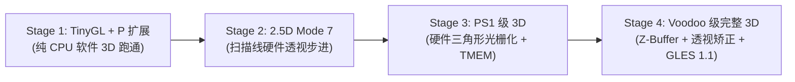

# AE350 3D 图形处理演进路线图（GFX3D）

> 适用机器：`mega138k_ae350`（板卡 `mega138k_pro`）。
> 状态：**架构规划与演进设计规范**。基于已完成的 GFX2D（PPU Step 6a）2D 着色器流水线、AndesCore A25 硬核算力（800MHz、FPU `FD` 扩展、DSP `P` 扩展）以及 GW5AST-138B FPGA 硬件资源。

---

## 1. 架构目标与总体设计理念

在 `mega138k_ae350` 平台上，3D 图形加速并非从零构建一套庞大臃肿的现代 GPU，而是**立足于经典 3D 硬件体系（PS1、N64、3dfx Voodoo 1 时代）与现代嵌入式标准（OpenGL ES 1.1 / TinyGL）**，构建一套**CPU 几何浮点/DSP 与 FPGA 高带宽定点光栅化无缝协同的混合 3D 渲染架构**。

```mermaid
flowchart TD
    subgraph CPU["CPU 几何与控制面 (Andes A25 @ 800MHz)"]
        APP["3D 应用程序 / 游戏 (Quake, LVGL 3D, Demo)"] --> GLES["OpenGL ES 1.1 / TinyGL API"]
        GLES --> STATE["OpenGL 状态机 (当前矩阵, 光源, 纹理)"]
        STATE --> VERTEX["顶点几何与变换管线 (FPU + Andes libdsp)"]
        VERTEX --> CLIP["视锥裁剪与透视 W 除法 (硬件除法器)"]
        CLIP --> TRI_EMIT["屏幕空间三角形装配 (x, y, z, u, v, rgba)"]
    end

    TRI_EMIT -->|DMA / 命令队列| RASTER

    subgraph FPGA["FPGA 数据面与像素流水线 (GW5AST-138B @ 100MHz DDR UI)"]
        RASTER["三角形跨度生成器 (Triangle Setup & Span Walker)"]
        TMEM["片上双缓冲纹理区 TMEM (8~16KB BSRAM)"] -.-> SAMPLER["定点双线性采样 (复用 Step 6c 12-DSP)"]
        RASTER --> SAMPLER
        SAMPLER --> SIMD["4 通道 SIMD ALU (现成 Phase 2: MUL_UNORM8 / LERP / DOT3)"]
        ZBUF["DDR3 16-bit Z-Buffer"] <-->|深度比对 (DISCARD)| SIMD
        SIMD --> PACKER["Bayer 抖动与打包写回 (现成 Phase 3)"]
        PACKER --> DDR3["DDR3 显存 Framebuffer (RGB565 / XRGB8888)"]
    end
```

### 核心分工原则

1. **浮点归 CPU，定点归 FPGA**：
   - 复杂灵活的 **3D 空间矩阵变换、摄像机投影、法线归一化、多光源计算** 均运行在 CPU 端，直接利用 A25 的 800MHz 硬件 FPU（`fadd.s`, `fmul.s`, `fsqrt.s`）与 DSP 向量指令集。
   - 规则机械的 **逐像素扫描线插值、纹理双线性采样、深度 Z 比较、色彩 Alpha 混合** 全部交由 FPGA 硬件流水线以纯定点数/整数高速吞吐。
2. **对上暴露标准 API**：
   - 向上层暴露标准 **OpenGL ES 1.1**（同时支持 `GLfloat` 浮点与 `GLfixed` 定点）头文件 `<GLES/gl.h>`，使已有 3D 游戏（如 Quake 1）、嵌入式 GUI（如 LVGL 3D 控件）与复古模拟器能够零门槛移植运行。

---

## 2. 软硬件基础与算力契约

### 2.1 CPU 算力（AndesCore A25 @ 800MHz, `rv32imafdc`）

| 子模块 / 扩展 | 硬件能力 | 在 3D 管线中的职责 | 预期算力与性能 |
| :--- | :--- | :--- | :--- |
| **硬件 FPU (`FD`)** | 单/双精度 IEEE-754 | 4×4 MVP 矩阵相乘、视锥剔除、透视投影 | 单精度浮点 1~3 拍，每秒可变换百万级 3D 顶点 |
| **Andes DSP (`P`)** | Packed-SIMD (4×8b / 2×16b) | 顶点法线点积光照、定点矩阵乘加、音频混音 | 单周期完成 2×16b MAC，兼容 ARM CMSIS-DSP |
| **硬件乘除法器 (`M`)** | 32-bit 乘除法 | 透视除法（$X/W, Y/W, Z/W$） | 单条 `div` 指令直接完成透视归一化 |
| **L1 Cache / TCM** | 32KB I/D Cache + 64KB ILM/DLM | 存放顶点缓冲区与 TinyGL 活跃状态 | 零内存等待执行核心几何管线 |

### 2.2 FPGA 硬件资源（GW5AST-138B 资源余量）

| 硬件原语 | 芯片总数 | 当前占用 (Step 6a) | 剩余可用 | 3D 拓展预计增量 | 占比说明 |
| :--- | :--- | :--- | :--- | :--- | :--- |
| **Logic (LUT4)** | 138,240 | 56,450 (41%) | **81,790** | +3,500 ~ 6,000 | 仅增加三角形光栅化与命令装配 |
| **硬核 DSP (MULT27X18)** | 298 | 27.5 (10%) | **270.5** | +12 ~ 16 | 双线性插值与深度比较 |
| **BSRAM (18Kb 块)** | 340 | 143 (43%) | **197** | +8 ~ 16 (16~32KB) | 用于片上 TMEM 纹理与 Span 缓冲 |
| **DDR3 带宽** | 3,200 MB/s | ~600 MB/s (显示+2D) | **>2,500 MB/s** | 消耗约 400~800 MB/s | 足以支撑 640×480 @ 60 FPS 带 Z-Buffer |

---

## 3. 分阶段演进路线图（Milestones）

演进遵循“**先纯软件验证状态机 $\to$ 再加速扫描线透视 $\to$ 终至完整硬件光栅化器**”的稳健推进路线：



---

### Stage 1：TinyGL + Andes P-扩展优化（纯 CPU 软件 3D 验证）

> **目标**：在不改动任何 FPGA 硬件的前提下，利用 CPU 的硬核 FPU、P 扩展指令集与 GFX2D 双缓冲帧交换，跑通完整的 OpenGL 1.1 软件渲染栈。

1. **核心交付**：
   - 引入并重构 **TinyGL**（Fabrice Bellard 开源的 5000 行纯 C OpenGL 1.1 子集）；
   - 编写 `tinygl_andes_dsp.h`，复用 Andes 官方 `libdsp` 及 CMSIS-DSP 兼容接口：
     - **热点 1（`vertex.c`）**：使用 A25 硬件 FPU / `mat_mult` 加速顶点 4×4 MVP 变换；
     - **热点 2（`light.c`）**：使用 DSP 向量内积指令加速顶点法线与光源点积；
     - **热点 3（`ztriangle.c`）**：使用 `padd16`、`clip` 和 `pkbb16` 优化三角形扫描线内层循环；
   - GFX2D 提供底层物理显存双缓冲交换接口 `ae350_gfx2d_flip()`。
2. **验证与验收门禁**：
   - 编译经典 3D 测试程序（旋转彩色立方体、纹理茶壶、简单的 Quake 1 地图跑动）；
   - 在 $320\times 240$ 分辨率下达到 **$\ge 45\sim 60\text{ FPS}$**；
   - 在 $640\times 480$ 分辨率下达到 **$\ge 20\sim 30\text{ FPS}$**。

---

### Stage 2：2.5D 扫描线透视步进器（Mode 7 架构）

> **目标**：在 GFX2D 硬件内引入逐行可编程的仿射/透视步进，实现超任 / GBA《马里奥赛车》风格的地面大透视拉伸。

1. **核心交付**：
   - 扩展 GFX2D 寄存器面：增加 `OP_SCANLINE_AFFINE`（或扩展 `OP_SCALE_BLIT`）；
   - 允许 CPU 传入一个包含每一行参数的轻量描述符表（每行起始 $U_0, V_0$ 与步长 $dU/dx, dV/dx$）；
   - 复用 Step 6c 规划的 48-bit `UQ32.16` UV 步进器与双线性插值单元；
   - 硬件按行读取源地面纹理，实时插值后连续写回目标显存。
2. **验证与验收门禁**：
   - 跑通伪 3D 赛车地面与飞行模拟地表拉伸 Demo；
   - 单帧地面透视渲染耗时在 $640\times 480$ 下 **$< 5\text{ ms}$**（跑满 60 FPS 无压力）。

---

### Stage 3：PS1 级仿射 3D 硬件光栅化器（Triangle Rasterizer + TMEM）

> **目标**：将三角形的光栅化计算从 CPU 卸载到 FPGA 硬件，实现正统 PS1 风格的纹理 3D 渲染。

1. **核心交付**：
   - **硬件三角形设置器（Triangle Setup & Span Generator）**：
     - 输入 3 个屏幕空间顶点 $(x_0, y_0), (x_1, y_1), (x_2, y_2)$；
     - 计算各边缘斜率，按扫描线分解为若干水平跨度（Span：$y, x_{start}, x_{end}, u_{start}, v_{start}, c_{start}$）；
   - **片上纹理缓冲（TMEM，8KB~16KB BSRAM）**：
     - CPU 在渲染前将当前材质块（如 $32\times 32$ 或 $64\times 64$）装入片上 TMEM；
     - 三角形内部采样时直接从 TMEM 读出，彻底消除 DDR3 乱序采样停顿；
   - **复用现有 GFX2D 核心**：
     - 片元着色直接走现有的 Phase 2 SIMD 4-Channel ALU（`MUL_UNORM8` 算材质×顶点光照）；
     - 写回直接走现有的 Phase 3（Bayer 抖动与 RGB565 打包）；
   - **TinyGL 驱动改造**：
     - 将 TinyGL 的 `gl_draw_triangle` 函数重定向为向 FPGA GFX3D 硬件 FIFO 提交顶点结构体。
2. **验证与验收门禁**：
   - 经典 3D 模型（多边形数 1000~3000）以 640×480 60 FPS 满速流畅旋转；
   - 综合与 PnR 时钟收敛于 100MHz 0 TNS。

---

### Stage 4：完整 3D 硬件加速器（3dfx Voodoo 1 级别）

> **目标**：补齐 16-bit Z-Buffer 硬件深度测试与 $1/W$ 透视校正插值，提供生产级 OpenGL ES 1.1 接口。

1. **核心交付**：
   - **DDR3 16-bit Z-Buffer 通道**：
     - GFX2D 新增独立的 Z-Buffer 读写仲裁端口；
     - 像素着色前读取目标 $Z_{dest}$，与当前插值 $Z_{pixel}$ 比较（`GL_LEQUAL`）：
       - 若深度测试失败，直接触发内部现成的 **`DISCARD`** 机制；
       - 若测试通过，更新颜色缓冲区并回写新 $Z$ 值；
   - **$1/W$ 透视校正插值**：
     - 对 $U/W, V/W, 1/W$ 进行线性插值，利用片上小型倒数近似查表消除纹理形变；
   - **标准驱动包封装**：
     - 打包标准头文件 `<GLES/gl.h>`, `<GLES/egl.h>` 与库文件 `libGLESv1_CM.so`。
2. **验证与验收门禁**：
   - 原生运行开源经典 3D 游戏《Quake 1》（雷神之锤 1）；
   - 跑通复杂 3D 场景（Z-Buffer 遮挡关系完全正确，透明多边形 Alpha 混合正确）；
   - 整体时序在 GW5AST-138B 上全时钟域 0 TNS 闭合。

---

## 4. 关键数据格式与硬件合同

### 4.1 定点数与坐标精度规范

```
32-bit 屏幕像素与纹理坐标 (UQ16.16):
┌────────────────────────┬────────────────────────┐
│  高 16 位：整数像素坐标  │  低 16 位：子像素小数精度  │
└────────────────────────┴────────────────────────┘
31                      16 15                    0

16-bit 顶点法线与光照定点数 (Q1.15):
┌──┬─────────────────────────────────────────────┐
│S │ 15 位定点小数数值 (-1.0000 ~ +0.9999)         │
└──┴─────────────────────────────────────────────┘
15 14                                            0

16-bit 深度缓冲区 (Z-Buffer):
0x0000 (最近剪裁面 Near) ──────────────► 0xFFFF (最远剪裁面 Far)
```

### 4.2 3D 三角形硬件描述符包格式（Hardware Triangle Packet）

当 CPU 向 FPGA 提交三角形绘制指令时，通过命令 FIFO 写入 64 字节规整数据包：

| 偏移 | 字段名 | 类型 | 说明 |
| :--- | :--- | :--- | :--- |
| `0x00` | `FLAGS_OP` | `uint32_t` | `OP=5` (TRI_RENDER), 包含着色模式、深度测试开关、混合模式 |
| `0x04` | `V0_XY` | `uint32_t` | 顶点 0 屏幕坐标（X: 16位定点, Y: 16位定点） |
| `0x08` | `V0_Z` | `uint32_t` | 顶点 0 深度值（16位定点 + 16位保留） |
| `0x0C` | `V0_UV` | `uint32_t` | 顶点 0 纹理坐标（U: 16位定点, V: 16位定点） |
| `0x10` | `V0_RGBA`| `uint32_t` | 顶点 0 漫反射色彩（8:8:8:8） |
| `0x14~0x20`| `V1_*` | - | 顶点 1 相应参数包 |
| `0x24~0x30`| `V2_*` | - | 顶点 2 相应参数包 |
| `0x34~0x3C`| `TEX_CFG`| `uint32_t` | 当前绑定的片上 TMEM 纹理尺寸、格式与滤波模式 |

---

## 5. 总结与演进建议

通过将 **Andes A25（800MHz FPU/DSP）** 的高灵活性浮点/几何处理能力，与 **GW5AST-138B GFX2D（100MHz DDR3 UI）** 的高带宽定点流式光栅化深度整合：

- 我们可以避免在 FPGA 上消耗数万 LUT 去硬造现代臃肿的浮点着色核心；
- 采用经过历史验证的**“CPU 几何浮点/DSP + FPGA 定点光栅化”黄金搭档**，以极低的资源占用和极高的确定性，在嵌入式 FPGA 上优雅落地完整的 3D 渲染与 OpenGL ES 1.1 标准生态。
