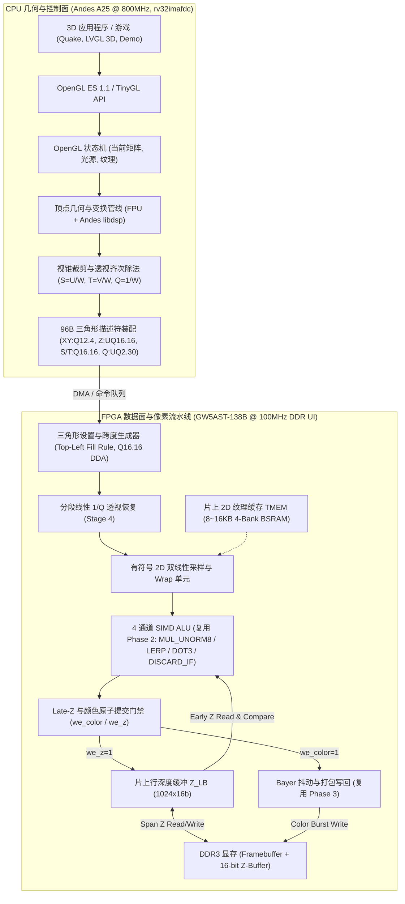
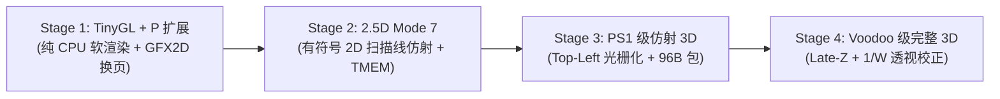
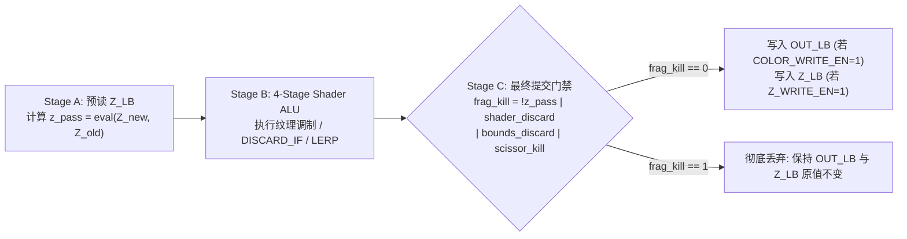

# AE350 3D 图形处理演进路线图与软硬件接口规范（GFX3D）

> 适用机器：`mega138k_ae350`（板卡 `mega138k_pro`）。
> 状态：**演进路线图与软硬件接口设计规范（预研/待实现）**。
> 基线锚点：文中“当前基线（Step 6a）”资源数据引自实测全量 PnR 回执 `build/runs/20261111T175107778773Z`（Commit `d6d7cfe`，Gateware `719806b12dd2`）及板级验收回执 `build/runs/20261111T191108626301Z`；所有 Stage 1..4 的资源增量与帧率指标均为**限定工况下的目标设计预算（Design Budget）**，不代表已验收的硬件能力。

---

## 1. 架构目标与总体设计理念

在 `mega138k_ae350` 平台上，3D 图形加速立足于经典 3D 硬件体系（PS1、N64、3dfx Voodoo 1）与嵌入式标准（OpenGL ES 1.1 / TinyGL），构建一套 **CPU 几何浮点/DSP 与 FPGA 高带宽定点光栅化无缝协同的混合 3D 渲染架构**。



### 核心分工原则

1. **浮点归 CPU，定点归 FPGA**：
   - **CPU 端**：承担 **3D 空间 4×4 矩阵变换、摄像机投影、法线光照、齐次裁剪及顶点级 $1/W$ 预计算**，直接利用 A25 的 800MHz 硬件 FPU（`fadd.s`, `fmul.s`, `fdiv.s`）与 DSP 向量指令集。
   - **FPGA 端**：承担 **Top-Left 边界跨度生成、逐像素 DDA 插值、2D TMEM 纹理双线性采样、片元着色、Late-Z 深度测试与 Alpha 混合写回**，内部全链路采用定点数与归一化整数。
2. **对上暴露标准 API**：
   - 向上层暴露标准 **OpenGL ES 1.1**（`GLfloat` Common 与 `GLfixed` Common-Lite）头文件 `<GLES/gl.h>`。

---

## 2. 软硬件算力基线与资源预算

### 2.1 CPU 算力分工（AndesCore A25 @ 800MHz, `rv32imafdc`）

| 子模块 / 扩展 | 硬件能力 | 在 3D 管线中的职责 | 目标算力预估（待实测） |
| :--- | :--- | :--- | :--- |
| **硬件 FPU (`FD`)** | 单/双精度 IEEE-754 | 4×4 MVP 矩阵相乘、视锥裁剪、顶点 $Q=1/W$ 与 $S=U/W, T=V/W$ 计算 | 单顶点几何变换约 40~60 周期 |
| **Andes DSP (`P`)** | Packed-SIMD (4×8b / 2×16b) | 顶点法线点积光照（`Q1.15`）、Stage 1 软件扫描线内层加速 | 单周期 2×16b MAC，兼容 CMSIS-DSP |
| **L1 Cache / TCM** | 32KB I/D Cache + 64KB ILM/DLM | 存放活跃顶点队列、Mode 7 行参数表与 TinyGL 状态机 | 降低 DDR 控制面读取带宽占用 |

### 2.2 FPGA 硬件资源基线与 3D 拓展预算（GW5AST-138B）

> **基线说明**：“Step 6a 实测基线”来自全量 PnR 回执 `20261111T175107778773Z`（Commit `d6d7cfe`，`ddr_ui_clk` 100MHz 0 TNS）；“Stage 2..4 预算增量”为架构设计上限目标。

| 硬件原语 | 芯片总数 | Step 6a 实测基线 | 剩余可用 | Stage 2..4 目标增量预算 | 新增模块构成说明 |
| :--- | :--- | :--- | :--- | :--- | :--- |
| **Logic (LUT4)** | 138,240 | 56,450 (41%) | **81,790** | **+4,500 ~ 7,000** | 三角形 Setup、DDA 步进、1/Q 插值与 Late-Z 控制 |
| **硬核 DSP (MULT27X18)** | 298 | 27.5 (10%) | **270.5** | **+16 ~ 22** | 双线性插值 (12 DSP) + 透视恢复与斜率乘法 (4~10 DSP) |
| **BSRAM (18Kb 块)** | 340 | 143 (43%) | **197** | **+10 ~ 18** | 2D TMEM 纹理缓存 (8~16 BSRAM) + `Z_LB` 行深度缓冲 (2 BSRAM) |

---

## 3. 分阶段演进路线图与工况门禁



### Stage 1：TinyGL + Andes P-扩展优化（纯 CPU 软件 3D 验证）

1. **核心交付**：
   - 引入 **TinyGL**（纯 C OpenGL 1.1 子集），使用 A25 硬件 FPU 加速 `vertex.c` MVP 变换，使用 P-扩展优化 `ztriangle.c` 扫描线步进；
   - GFX2D 仅负责帧缓冲清屏（`FILL_RECT`）、UI 叠加与双缓冲交换。
2. **目标工况与验证门禁**：
   - **基准负载**：单纹理 3D 旋转网格（1,000 三角形，平均屏幕覆盖率 30%，单光源 Gouraud 着色，开启软件 16-bit Z-Buffer）；
   - **目标性能指标（待实测）**：$320\times 240$ 分辨率下目标 $\ge 45\text{ FPS}$；$640\times 480$ 下目标 $\ge 20\text{ FPS}$。

---

### Stage 2：2.5D 扫描线任意仿射引擎（Mode 7 独立合同）

> **[!IMPORTANT] 与 Step 6c 轴对齐缩放的边界区分**
> `gfx2d-shader-core.md` §3.1 定义的 Step 6c（`OP_SCALE_BLIT`）为**无符号 `UQ32.16`、单调递增、轴对齐（$dU/dy=0, dV/dx=0$）**合同，且依赖 1D 行缓冲 `SRC_LB0/1` 预取。
> **Mode 7 地面旋转场景下，单条水平扫描线在源纹理上沿斜线行进（$U, V$ 同时变化且步长可正可负），因此绝不能直接复用 Step 6c 的无符号轴对齐行预取通路**，必须实现以下独立的 `OP_SCANLINE_AFFINE` 合同：

1. **有符号梯度与 48-bit `Q32.16` 双向步进合同**：
   - CPU 按行提供扫描线仿射参数表（每行 16 字节：`U0`, `V0`, `dU_dx`, `dV_dx`，均为 **32-bit 二进制补码有符号定点数 `Q16.16`**，覆盖范围 $[-32768.0, +32767.99998]$）；
   - 硬件内部将起始值与梯度符号扩展至 **48-bit 有符号 `Q32.16`** 累加器：
     $$U(x) = \text{sext48}(U_0) + x \cdot \text{sext48}\!\left(\frac{dU}{dx}\right), \quad V(x) = \text{sext48}(V_0) + x \cdot \text{sext48}\!\left(\frac{dV}{dx}\right)$$
   - 每个像素时钟周期同时更新 $U(x)$ 与 $V(x)$，支持 $0^\circ \sim 360^\circ$ 任意角度旋转与反向步进。
2. **片上 2D TMEM 采样缓存合同（替代 1D `SRC_LB`）**：
   - 由于斜向扫描线跨越多行源纹理，`OP_SCANLINE_AFFINE` 绕过 1D `SRC_LB0/1`，直接从 **片上 2D TMEM（8~16KB BSRAM，组织为 $(u\text{ 奇偶}) \times (v\text{ 奇偶})$ 4-Bank 并行阵列）** 采样；
   - 任意坐标 $(U, V)$ 的 $2\times 2$ 双线性邻域像素（`P00, P10, P01, P11`）在单拍内从 4 个 Bank 同时读出（`II=1`，零行缺失停顿）；
   - 超出单块 TMEM 容量的巨型地面采用 Tile Map 索引或由驱动按目标区域分块提交。
3. **负数与越界纹理寻址模式（`TEX_WRAP_U / TEX_WRAP_V`）**：
   - 取整数像素坐标 $u_{\text{int}} = U[47:16], v_{\text{int}} = V[47:16]$（有符号 32-bit 整数）与子像素权重 $\alpha_u = U[15:8], \alpha_v = V[15:8]$：
     - **`0 = WRAP_REPEAT`（幂次周期回绕）**：要求纹理宽高为 $2^k$（如 $64\times 64$），$u_{\text{idx}} = u_{\text{int}} \ \& \ (\text{TEX\_W} - 1)$，二进制补码掩码天然支持负坐标平滑周期重复；
     - **`1 = WRAP_CLAMP`（边缘夹紧）**：$u_{\text{idx}} = \min(\max(u_{\text{int}}, 0), \text{TEX\_W} - 1)$；
     - **`2 = WRAP_BORDER_DISCARD`（越界丢弃/背景替换）**：当 $u_{\text{int}} < 0 \lor u_{\text{int}} \ge \text{TEX\_W} \lor v_{\text{int}} < 0 \lor v_{\text{int}} \ge \text{TEX\_H}$ 时，置位 `bounds_discard = 1`（跳过目标写入或填充地平线 `BG_COLOR`）。
4. **验证门禁**：
   - 单元测试覆盖 $90^\circ / 180^\circ / 270^\circ / 37^\circ$（含负梯度 $dU/dx < 0, dV/dx < 0$）扫描线采样，与软件黄金模型 Bit-Exact 一致。

---

### Stage 3：PS1 级仿射 3D 硬件光栅化器（Triangle Rasterizer + TMEM）

1. **核心交付**：
   - 落地遵守 **§4.3 Top-Left Fill Rule** 的硬件三角形设置与跨度生成器（Triangle Setup & Span Walker）；
   - 实现 **§4.2 96 字节三角形硬件描述符** 解析（此时 `PERSP_EN = 0`，直接对 `V_S, V_T` 做仿射线性插值）；
   - 片元着色复用 GFX2D Phase 2 SIMD ALU（`MUL_UNORM8` 执行纹理色 × Gouraud 顶点色调制，`DISCARD_IF` 执行色键剔除）。
2. **目标工况与验证门禁**：
   - **共享边无缝验证（必测门禁）**：用两个共享斜边的三角形拼合为 $64\times 64$ 矩形（涵盖轴对齐与旋转 $30^\circ$ 两种姿态），开启 50% Alpha Blend（`LERP`）绘制到纯色背景；断言矩形内所有像素**严格只被混合一次（0 裂缝漏画像素、0 共享边双重混合像素）**；
   - **目标性能预算（待实测）**：在 $640\times 480$ 分辨率、单帧 1,500 个有效三角形（平均面积 120 像素，总光栅化片元约 $1.8\times 10^5$/帧，常驻 64×64 TMEM 纹理）工况下，目标帧率 $\ge 60\text{ FPS}$；Gowin PnR 保持 100MHz 0 TNS。

---

### Stage 4：完整 3D 硬件加速器（Late-Z + $1/W$ 透视校正）

1. **核心交付**：
   - 实现 **§4.4 Late-Z 深度测试与独立写掩码流水线**（支持不透明物体遮挡与半透明物体只读 Z 混合）；
   - 实现 **§4.2 `PERSP_EN = 1` 齐次透视校正插值**（对 $S=U/W, T=V/W, Q=1/W$ 线性步进，每 8 像素通过倒数查表 + 一阶牛顿迭代恢复精确 $W = 1/Q$，跨度内线性插值恢复 $(U, V)$）；
   - 封装 `<GLES/gl.h>` 与 `libGLESv1_CM` 驱动栈。
2. **目标工况与验证门禁**：
   - **透视矫正门禁**：大倾角（$75^\circ$ 俯视）棋盘格地面三角形，对比 `PERSP_EN=0` 与 `PERSP_EN=1`，消除对角线折痕扭曲，与浮点参考误差 $\le 0.5\text{ texel}$；
   - **透明与 Discard 深度一致性门禁**：先绘制不透明背景墙（$Z=0.8$），再绘制带 `DISCARD_IF` 镂空像素的前景栅栏（$Z=0.3, \text{Z\_WRITE\_EN}=1$），最后在两者之间绘制半透明玻璃（$Z=0.5, \text{Z\_TEST\_EN}=1, \text{Z\_WRITE\_EN}=0, \text{BLEND\_EN}=1$）；验证栅栏镂空处不会阻挡后方半透明玻璃，且半透明玻璃不会改写 Z-Buffer；
   - **目标性能预算（待实测）**：$640\times 480$ 分辨率、单帧 2,000 三角形、平均深度重叠率（Overdraw）$\le 1.5\times$、TMEM 切换 $\le 16$ 次/帧、30% 半透明混合片元负载下，目标帧率 $\ge 60\text{ FPS}$。

---

## 4. 核心硬件合同与数据格式规范

### 4.1 定点数与数值精度合同（消除位宽冲突）

为保证驱动层描述符打包与 RTL 内部数据通路严格一致，各物理量的位宽、符号与小数点位置定义如下：

| 物理量 | 描述符字段位宽与格式 | RTL 内部步进器格式 | 数值范围与精度说明 |
| :--- | :--- | :--- | :--- |
| **顶点屏幕坐标 ($X, Y$)** | **16-bit 有符号 `Q12.4`**<br/>（打包于 32-bit `V_XY`） | **32-bit 有符号 `Q16.16`** | 整数范围 $[-2048, +2047]$（含帧缓冲外 Guard-band 裁剪区），子像素精度 $1/16\text{ px}$ |
| **屏幕深度 ($Z$)** | **32-bit 无符号 `UQ16.16`**<br/>（独立 32-bit `V_Z`） | **32-bit 无符号 `UQ16.16`** | 高 16 位 `V_Z[31:16]` 直接对应 DDR3 16-bit Z-Buffer 值（`0x0000` 近 $\to$ `0xFFFF` 远），低 16 位用于扫描线子精度插值 |
| **齐次纹理坐标 ($S, T$)** | **32-bit 有符号 `Q16.16`**<br/>（独立 32-bit `V_S`, `V_T`） | **48-bit 有符号 `Q32.16`** | 透视模式下存 $S = U/W, T = V/W$；仿射模式下（$W=1$）直接存有符号纹理坐标 $(U, V)$，支持负坐标与 Repeat 回绕 |
| **齐次倒数权重 ($Q$)** | **32-bit 无符号 `UQ2.30`**<br/>（独立 32-bit `V_Q`） | **32-bit 无符号 `UQ2.30`** | 表示 $Q = 1/W \in [0, 4.0)$，其中 $1.0 = \text{0x4000\_0000}$；仿射模式下固定填 `0x40000000` |
| **顶点颜色 ($R, G, B, A$)** | **4 × 8-bit `UNORM8`**<br/>（打包于 32-bit `V_RGBA`） | **4 × 24-bit 有符号 `Q15.8`** | 扫描线 Gouraud 插值保留 8 位小数精度，送入 Shader ALU 前截断并饱和至 `[0, 255]` |

```
V_XY 寄存器 (32-bit 打包双 Q12.4 有符号屏幕坐标):
┌───────────────────────────┬───────────────────────────┐
│   Y_q12_4 (16b Signed)    │   X_q12_4 (16b Signed)    │
│ [31]符号 [30:20]整 [19:16]小│ [15]符号 [14:4]整 [3:0]小  │
└───────────────────────────┴───────────────────────────┘
 31                       16 15                        0

V_Z 寄存器 (32-bit UQ16.16 深度值):
┌───────────────────────────┬───────────────────────────┐
│  16-bit Z-Buffer 整数深度  │   16-bit 跨度插值小数位    │
└───────────────────────────┴───────────────────────────┘
 31                       16 15                        0

V_S / V_T 寄存器 (各 32-bit Q16.16 有符号齐次纹理坐标):
┌──┬────────────────────────┬───────────────────────────┐
│S │  15-bit 有符号整数部分   │   16-bit 纹理子像素小数    │
└──┴────────────────────────┴───────────────────────────┘
 31 30                    16 15                        0

V_Q 寄存器 (32-bit UQ2.30 齐次权重 1/W):
┌────┬──────────────────────────────────────────────────┐
│2b整│             30-bit 小数部分 (1.0 = 0x40000000)    │
└────┴──────────────────────────────────────────────────┘
 31 30 29                                              0
```

---

### 4.2 96 字节 3D 三角形硬件描述符包合同（Hardware Triangle Packet）

每个三角形绘制命令由 **24 个 32-bit 字（共 96 字节 = 3 个 256-bit DDR3 UI Beat）** 组成，彻底消除坐标位宽压缩冲突并完整携带透视参数：

| 字节偏移 | 字索引 | 字段名 | 格式与类型 | 详细位域与语义说明 |
| :--- | :--- | :--- | :--- | :--- |
| `0x00` | W0 | `FLAGS_OP` | `uint32_t` | `[3:0]` `OP=5` (`TRI_RENDER`)<br/>`[4]` `Z_TEST_EN`（深度测试使能）<br/>`[5]` `Z_WRITE_EN`（深度写入使能，独立于测试）<br/>`[8:6]` `Z_FUNC`（`0=NEVER, 1=LESS, 2=EQUAL, 3=LEQUAL, 4=GREATER, 5=NOTEQUAL, 6=GEQUAL, 7=ALWAYS`）<br/>`[9]` `COLOR_WRITE_EN`（颜色写入使能）<br/>`[10]` `PERSP_EN`（`0`=Stage 3 仿射 UV，`1`=Stage 4 $1/W$ 透视校正）<br/>`[11]` `GOURAUD_EN`（`0`=平面着色取 V0 颜色，`1`=三顶点平滑插值）<br/>`[31:16]` 透传至 `SHADER_CFG[15:0]`（控制 `LAST_STAGE`, `DITHER_EN` 等） |
| `0x04` | W1 | `TEX_CFG` | `uint32_t` | `[0]` `TEX_EN`，`[1]` `BILINEAR_EN`<br/>`[3:2]` `WRAP_U`（`0=REPEAT, 1=CLAMP, 2=BORDER_DISCARD`）<br/>`[5:4]` `WRAP_V`（同上）<br/>`[8:6]` `TEX_FMT`（复用 GFX2D 格式编码）<br/>`[15:12]` `LOG2_TEX_W`，`[19:16]` `LOG2_TEX_H`<br/>`[31:20]` `TMEM_BASE_OFFSET`（片上 TMEM 起始字偏移） |
| `0x08` | W2 | `ZBUF_CFG` | `uint32_t` | `[31:5]` `ZBUF_BASE[31:5]`（DDR3 16-bit Z-Buffer 32B 对齐基址；Stride 固定等于目标 `DST_WIDTH × 2`） |
| `0x0C` | W3 | `V0_XY` | `2 × Q12.4` | 顶点 0 屏幕坐标：`[15:0] = X0_q12_4`，`[31:16] = Y0_q12_4` |
| `0x10` | W4 | `V0_Z` | `UQ16.16` | 顶点 0 屏幕深度 $Z_0$ |
| `0x14` | W5 | `V0_S` | `Q16.16` | 顶点 0 水平齐次纹理坐标 $S_0 = U_0 / W_0$（`PERSP_EN=0` 时为 $U_0$） |
| `0x18` | W6 | `V0_T` | `Q16.16` | 顶点 0 垂直齐次纹理坐标 $T_0 = V_0 / W_0$（`PERSP_EN=0` 时为 $V_0$） |
| `0x1C` | W7 | `V0_Q` | `UQ2.30` | 顶点 0 齐次倒数权重 $Q_0 = 1 / W_0$（`PERSP_EN=0` 时填 `0x40000000`） |
| `0x20` | W8 | `V0_RGBA` | `4 × UNORM8` | 顶点 0 颜色 `{A0, R0, G0, B0}` |
| `0x24~0x38` | W9..W14 | `V1_*` | 同 V0 (6 Words) | 顶点 1 完整属性包（`V1_XY, V1_Z, V1_S, V1_T, V1_Q, V1_RGBA`） |
| `0x3C~0x50` | W15..W20 | `V2_*` | 同 V0 (6 Words) | 顶点 2 完整属性包（`V2_XY, V2_Z, V2_S, V2_T, V2_Q, V2_RGBA`） |
| `0x54` | W21 | `SCISSOR_MIN`| `2 × uint16` | 裁剪窗口左上角（含）：`[15:0] = MIN_X`，`[31:16] = MIN_Y` |
| `0x58` | W22 | `SCISSOR_MAX`| `2 × uint16` | 裁剪窗口右下角（含）：`[15:0] = MAX_X`，`[31:16] = MAX_Y` |
| `0x5C` | W23 | `RESERVED` | `uint32_t` | 保留字段（写 0，用于凑齐 96 字节 / 3 个 256-bit Beat） |

---

### 4.3 三角形光栅化覆盖规则（Top-Left Fill Rule 与子像素舍入合同）

为彻底消除相邻共边三角形拼接时的**像素裂缝（Gaps）**或**共享边双重绘制（Double-blending）**，硬件光栅化器严格执行以下确定性几何合同：

1. **像素中心定义与子像素网格**：
   - 输入顶点坐标 $(X_i, Y_i)$ 为有符号 `Q12.4`（最小步长 $1/16$ 像素）。
   - 整数屏幕像素 $(X_p, Y_p) \in \mathbb{Z}^2$ 的**采样中心固定位于 $(X_p + 0.5, Y_p + 0.5)$**（在 `Q12.4` 下对应低 4 位小数为 `4'b1000`）。
2. **有向面积与退化三角形剔除**：
   - 计算两倍有向面积（`Q24.8` 精确整数）：
     $$E_{\text{area}} = (X_1 - X_0)(Y_2 - Y_0) - (Y_1 - Y_0)(X_2 - X_0)$$
   - 若 $E_{\text{area}} == 0$（三点共线或零面积退化三角形），硬件在 Setup 阶段直接置 `DONE` 退出，**发射 0 条跨度**。
   - 若 $E_{\text{area}} < 0$（屏幕空间逆时针/背面），硬件可根据剔除模式直接丢弃，或自动交换 $V_1 \leftrightarrow V_2$ 归一化为正面积方向。
3. **左上填充准则（Top-Left Fill Rule）**：
   - 对归一化正面积三角形的每条有向边 $E_{ab}: (X_a, Y_a) \to (X_b, Y_b)$：
     - **顶边（Top Edge）**：$\Delta Y = Y_b - Y_a == 0$ 且边位于三角形上方（水平边且内侧在下方）；
     - **左边（Left Edge）**：$\Delta Y = Y_b - Y_a \ne 0$ 且边位于三角形左侧（沿 $+Y$ 向下扫描时的左边界）。
   - **边界包含准则**：像素中心 $(X_p + 0.5, Y_p + 0.5)$ 被包含在三角形内，当且仅当它位于三角形严格内部，或**恰好落在顶边（Top Edge）或左边（Left Edge）上**；落在底边（Bottom Edge）或右边（Right Edge）上的采样点**严格不包含**。
4. **跨度端点定点数取整公式（Span Endpoint Rounding）**：
   - 垂直扫描线范围 $Y_p \in [Y_{\text{start}}, Y_{\text{end}}]$（`Q12.4` 算术）：
     $$Y_{\text{start}} = \max\!\left(\text{MIN\_Y},\ \left\lceil Y_{\min} - 0.5 \right\rceil\right) = (\text{Y\_min\_q12\_4} + \text{4'h7}) \gg 4$$
     $$Y_{\text{end}} = \min\!\left(\text{MAX\_Y},\ \left\lceil Y_{\max} - 0.5 \right\rceil - 1\right) = ((\text{Y\_max\_q12\_4} + \text{4'h7}) \gg 4) - 1$$
   - 在扫描线 $Y_{\text{sample}} = (Y_p \ll 4) + 8$ 处，由左右边方程插值得到 `Q16.16` 精确交点 $X_{\text{left}}, X_{\text{right}}$，水平像素跨度 $X_p \in [X_{\text{start}}, X_{\text{end}}]$ 为：
     $$X_{\text{start}} = \max\!\left(\text{MIN\_X},\ (\text{X\_left\_q16\_16} + \text{32'h0000\_7FFF}) \gg 16\right)$$
     $$X_{\text{end}} = \min\!\left(\text{MAX\_X},\ ((\text{X\_right\_q16\_16} + \text{32'h0000\_7FFF}) \gg 16) - 1\right)$$
   - 若某行计算出 $X_{\text{start}} > X_{\text{end}}$，该行跨度为空，直接步进至下一行。
5. **属性插值子像素预对齐（Subpixel Pre-stepping）**：
   - 所有属性（$Z, S, T, Q, R, G, B, A$）在起始像素中心 $(X_{\text{start}} + 0.5, Y_p + 0.5)$ 处必须计入子像素偏移 $\delta_x = (X_{\text{start}} + 0.5) - X_{\text{left}}$，防止陡峭三角形出现纹理滑移。

---

### 4.4 深度测试、Late-Z 提交门禁与透明混合合同

为保证不透明遮挡、色键镂空（`DISCARD_IF`）与半透明混合（Alpha Blending）三者组合时的严格正确性，深度与颜色缓冲遵循以下流水线合同：



1. **读写分离与 Late-Z 原子提交门禁**：
   - 在进入 Shader ALU 之前，硬件从片上行深度缓冲 `Z_LB` 读取当前像素的旧深度 $Z_{\text{old}} = \text{Z\_LB}[X_p]$，并与插值深度 $Z_{\text{new}} = \text{V\_Z}[31:16]$ 按 `Z_FUNC` 比较得到布尔信号 `z_pass`（当 `Z_TEST_EN == 0` 时恒有 `z_pass = 1`）。**此时严禁提前修改 `Z_LB`**。
   - 片元流经 Stage 0..3 Shader ALU，执行色彩计算与 `DISCARD_IF` 指令，汇集产生 `shader_discard` 信号。
   - 在流水线最末级（Stage 3 退休拍），综合计算最终片元丢弃信号：
     $$\text{frag\_kill} = (\neg \text{z\_pass}) \lor \text{shader\_discard} \lor \text{bounds\_discard}$$
   - **写使能方程**：
     $$\text{we\_color} = \text{COLOR\_WRITE\_EN} \land (\neg \text{frag\_kill})$$
     $$\text{we\_z} = \text{Z\_WRITE\_EN} \land (\neg \text{frag\_kill})$$
2. **关键渲染场景行为保证**：
   - **镂空纹理 / 精灵（Alpha Test / Color-Key Cutout）**：配置 `Z_TEST_EN = 1, Z_WRITE_EN = 1`。被 `DISCARD_IF` 丢弃的透明像素满足 `shader_discard = 1` $\implies$ `frag_kill = 1` $\implies$ `we_z = 0`，**绝不会在 Z-Buffer 中留下幽灵遮挡**。
   - **半透明混合表面（Translucent Alpha Blend）**：按由远及近顺序渲染，配置 `Z_TEST_EN = 1, Z_WRITE_EN = 0`，Shader Stage 3 执行 `LERP(SRC, DST, SRC.a)`。被前景不透明物体挡住的片元因 `z_pass = 0` 被丢弃；未被挡住的片元正常混合写入 `OUT_LB`（`we_color = 1`），同时因 `Z_WRITE_EN = 0` **保持 `Z_LB` 不变**，不阻挡同位置后续叠加的半透明层。
   - **Z-Prepass / Shadow Mask**：配置 `Z_TEST_EN = 1, Z_WRITE_EN = 1, COLOR_WRITE_EN = 0`，仅更新深度缓冲不写颜色。

---

## 5. 总结与演进建议

通过明确定义 **96 字节含齐次透视参数的三角形描述符、Mode 7 有符号 2D TMEM 采样合同、Top-Left 子像素覆盖规则以及 Late-Z 独立写掩码门禁**，本规范与 `gfx2d-shader-core.md` 的底层行缓冲、4-Stage SIMD ALU 及写回打包器形成了严密的接口闭环，可直接作为后续 Stage 1..4 软硬件实施的工程契约。
