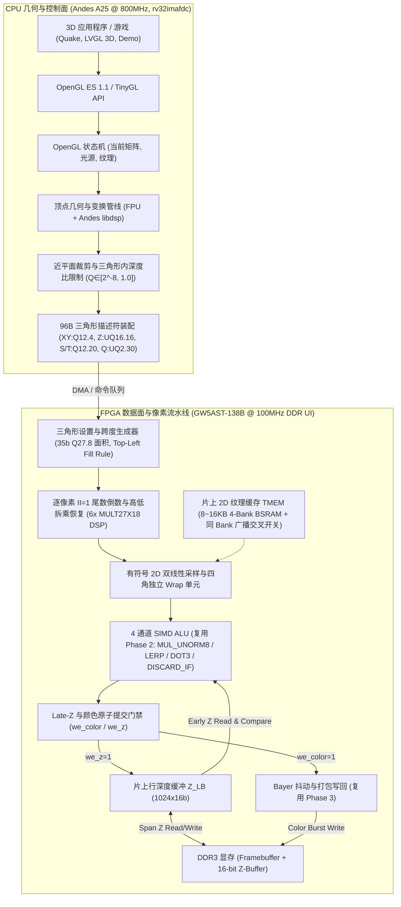
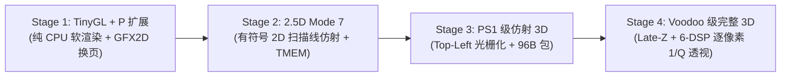
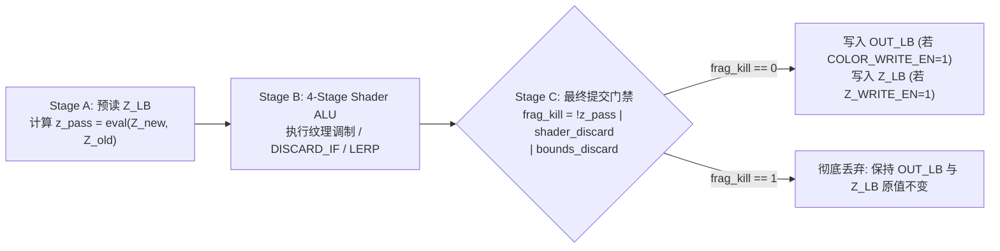

# AE350 3D 图形处理演进路线图与软硬件接口规范（GFX3D）

> 适用机器：`mega138k_ae350`（板卡 `mega138k_pro`）。
> 状态：**演进路线图与软硬件接口设计规范（预研/待实现）**。
> 基线锚点：文中“Step 6a 实测基线”资源数据引自 [gfx2d-shader-core.md §2](gfx2d-shader-core.md) 记录的全量 PnR 回执 `build/runs/20261111T175107778773Z-build-ae350-gfx2d-shader-timing-closure-opt22-f06773`（Commit `d6d7cfe`，Gateware `719806b12dd23325956c0656e40d3d4d41b4bc513b3cc0cfdf7da2b3c6b1cc5d`）及板级验收回执 `build/runs/20261111T191108626301Z-board-ae350-upload`（注：`build/runs/` 为本地未入库构建收据目录，跨工作区复核以 `gfx2d-shader-core.md` §2 归档表格为准）。所有 Stage 1..4 的资源增量与帧率指标均为**限定工况下的目标设计预算（Design Budget）**，不代表已验收的硬件能力。

---

## 1. 架构目标与总体设计理念

在 `mega138k_ae350` 平台上，3D 图形加速立足于经典 3D 硬件体系（PS1、N64、3dfx Voodoo 1）与嵌入式标准（OpenGL ES 1.1 / TinyGL），构建一套 **CPU 几何浮点/DSP 与 FPGA 高带宽定点光栅化无缝协同的混合 3D 渲染架构**。



### 核心分工原则

1. **浮点归 CPU，定点归 FPGA**：
   - **CPU 端**：承担 **3D 空间 4×4 矩阵变换、摄像机投影、法线光照、近平面齐次裁剪及顶点级 $Q=1/W$ 归一化**，直接利用 A25 的 800MHz 硬件 FPU（`fadd.s`, `fmul.s`, `fdiv.s`）与 DSP 向量指令集。
   - **FPGA 端**：承担 **Top-Left 边界跨度生成、逐像素高精度 DDA 插值、逐像素 $1/Q$ 尾数牛顿迭代与高低位拆分乘法恢复、2D TMEM 纹理双线性采样、片元着色、Late-Z 深度测试与 Alpha 混合写回**，内部全链路采用定点数与归一化整数。
2. **对上暴露标准 API**：
   - 向上层暴露标准 **OpenGL ES 1.1**（`GLfloat` Common 与 `GLfixed` Common-Lite）头文件 `<GLES/gl.h>`。

---

## 2. 软硬件算力基线与资源预算

### 2.1 CPU 算力分工（AndesCore A25 @ 800MHz, `rv32imafdc`）

| 子模块 / 扩展 | 硬件能力 | 在 3D 管线中的职责 | 目标算力预估（待实测） |
| :--- | :--- | :--- | :--- |
| **硬件 FPU (`FD`)** | 单/双精度 IEEE-754 | 4×4 MVP 矩阵相乘、近平面与深度比裁剪、顶点 $Q=1/W$ 归一化与 $S=U \cdot Q, T=V \cdot Q$ 计算 | 单顶点几何变换约 40~60 周期 |
| **Andes DSP (`P`)** | Packed-SIMD (4×8b / 2×16b) | 顶点法线点积光照（`Q1.15`）、Stage 1 软件扫描线内层加速 | 单周期 2×16b MAC，兼容 CMSIS-DSP |
| **L1 Cache / TCM** | 32KB I/D Cache + 64KB ILM/DLM | 存放活跃顶点队列、Mode 7 行参数表与 TinyGL 状态机 | 降低 DDR 控制面读取带宽占用 |

### 2.2 FPGA 硬件资源基线与 3D 拓展预算（GW5AST-138B）

> **基线说明**：“Step 6a 实测基线”引自 [gfx2d-shader-core.md §2](gfx2d-shader-core.md)（全量 PnR 回执 `20261111T175107778773Z`，Commit `d6d7cfe`，`ddr_ui_clk` 100MHz 0 TNS）；“Stage 2..4 预算增量”为架构设计上限目标。

| 硬件原语 | 芯片总数 | Step 6a 实测基线 | 剩余可用 | Stage 2..4 目标增量预算 | 新增模块构成说明 |
| :--- | :--- | :--- | :--- | :--- | :--- |
| **Logic (LUT4)** | 138,240 | 56,450 (41%) | **81,790** | **+4,800 ~ 7,500** | 三角形 Setup、40-bit DDA 步进、CLZ/NR 倒数流水线与 Late-Z 控制 |
| **硬核 DSP (MULT27X18)** | 298 | 27.5 (10%) | **270.5** | **+20 ~ 26** | 双线性插值 (12 DSP) + 逐像素 $1/Q$ 牛顿迭代 (2 DSP) + $S/T$ 高低字拆分恢复乘法 (4 DSP) + Setup 乘法 (2~8 DSP) |
| **BSRAM (18Kb 块)** | 340 | 143 (43%) | **197** | **+11 ~ 19** | 2D TMEM 纹理缓存 (8~16 BSRAM) + `Z_LB` 行深度缓冲 (2 BSRAM) + 倒数初值表 (1 BSRAM) |

---

## 3. 分阶段演进路线图与工况门禁



### Stage 1：TinyGL + Andes P-扩展优化（纯 CPU 软件 3D 验证）

1. **核心交付**：
   - 引入 **TinyGL**（纯 C OpenGL 1.1 子集），使用 A25 硬件 FPU 加速 `vertex.c` MVP 变换，使用 P-扩展优化 `ztriangle.c` 扫描线步进；
   - GFX2D 仅负责帧缓冲清屏（`FILL_RECT`）、UI 叠加与双缓冲交换。
2. **目标工况与验证门禁**：
   - **基准负载**：单纹理 3D 旋转网格（1,000 三角形，平均屏幕覆盖率 30%，单光源 Gouraud 着色，开启软件 16-bit Z-Buffer）；
   - **目标性能指标（待实测）**：$320\times 240$ 分辨率下目标 $\ge 45\text{ FPS}$；$640\times 480$ 下目标 $\ge 20\text{ FPS}$。

---

### Stage 2：2.5D 扫描线任意仿射引擎（Mode 7 独立合同）

> **[!IMPORTANT] 与 Step 6c 轴对齐缩放的边界区分**
> `gfx2d-shader-core.md` §3.1 定义的 Step 6c（`OP_SCALE_BLIT`）为**无符号 `UQ32.16`、单调递增、轴对齐（$dU/dy=0, dV/dx=0$）**合同，且依赖 1D 行缓冲 `SRC_LB0/1` 预取。
> **Mode 7 地面旋转场景下，单条水平扫描线在源纹理上沿斜线行进（$U, V$ 同时变化且步长可正可负），因此绝不能直接复用 Step 6c 的无符号轴对齐行预取通路**，必须实现以下独立的 `OP_SCANLINE_AFFINE` 合同：

1. **有符号梯度与 48-bit `Q32.16` 双向步进合同**：
   - CPU 按行提供扫描线仿射参数表（每行 16 字节：`U0`, `V0`, `dU_dx`, `dV_dx`，均为 **32-bit 二进制补码有符号定点数 `Q16.16`**，覆盖范围 $[-32768.0, +32767.99998]$）；
   - 硬件内部将起始值与梯度符号扩展至 **48-bit 有符号 `Q32.16`** 累加器：
     $$U(x) = \text{sext48}(U_0) + x \cdot \text{sext48}\!\left(\frac{dU}{dx}\right), \quad V(x) = \text{sext48}(V_0) + x \cdot \text{sext48}\!\left(\frac{dV}{dx}\right)$$
   - 每个像素时钟周期同时更新 $U(x)$ 与 $V(x)$，支持 $0^\circ \sim 360^\circ$ 任意角度旋转与反向步进。
2. **片上 2D TMEM 4-Bank 采样缓存与四角独立寻址合同（替代 1D `SRC_LB`）**：
   - `OP_SCANLINE_AFFINE` 绕过 1D `SRC_LB0/1`，直接从 **片上 2D TMEM（8~16KB BSRAM，按坐标最低位奇偶 `{v[0], u[0]}` 组织为 `Bank_EE (00)`, `Bank_EO (01)`, `Bank_OE (10)`, `Bank_OO (11)` 四个并行 Bank）** 采样；
   - 对当前像素的 48-bit 有符号纹理坐标 $(U, V)$，提取基点有符号整数与相邻点原始坐标（32-bit 有符号整数）：
     $$u_{\text{raw},0} = U[47:16], \quad u_{\text{raw},1} = U[47:16] + 1$$
     $$v_{\text{raw},0} = V[47:16], \quad v_{\text{raw},1} = V[47:16] + 1$$
   - 子像素插值权重为 $\alpha_u = U[15:8], \alpha_v = V[15:8]$（`UNORM8`；当 `BILINEAR_EN == 0` 时强制 $\alpha_u = 0, \alpha_v = 0$，仅使用 $(u_0, v_0)$）。
3. **四角独立 Wrap 函数、Clamp 同 Bank 广播与越界判定规则（`WRAP_U / WRAP_V`）**：
   - Wrap 映射函数 $\text{wrap}(c_{\text{raw}}, N, \text{mode})$ **对 $u_{\text{raw},0}, u_{\text{raw},1}$ 以及 $v_{\text{raw},0}, v_{\text{raw},1}$ 四个角点坐标分别独立求值**：
     - **`0 = WRAP_REPEAT`（幂次周期回绕）**：要求纹理尺寸 $N = 2^k$（如 $64\times 64$），定义：
       $$u_0 = u_{\text{raw},0} \ \& \ (\text{TEX\_W} - 1), \quad u_1 = (u_{\text{raw},0} + 1) \ \& \ (\text{TEX\_W} - 1)$$
       $$v_0 = v_{\text{raw},0} \ \& \ (\text{TEX\_H} - 1), \quad v_1 = (v_{\text{raw},0} + 1) \ \& \ (\text{TEX\_H} - 1)$$
       在纹理最右列 $u_{\text{raw},0} = \text{TEX\_W} - 1$（奇数）处，$u_0 = \text{TEX\_W} - 1$ 落入奇 Bank，而 $u_1 = 0$ 自动回绕至首列偶 Bank；四个角点 $(u_0, v_0), (u_1, v_0), (u_0, v_1), (u_1, v_1)$ 的奇偶性 `{v[0], u[0]}` 恒互不相同，单拍无冲突并行读出。
     - **`1 = WRAP_CLAMP`（边缘夹紧与同 Bank 广播）**：定义：
       $$u_k = \min(\max(u_{\text{raw},k},\ 0),\ \text{TEX\_W} - 1), \quad v_m = \min(\max(v_{\text{raw},m},\ 0),\ \text{TEX\_H} - 1) \quad (k, m \in \{0, 1\})$$
       当采样点到达或超出纹理边界（如 $u_{\text{raw},0} \ge \text{TEX\_W} - 1$ 或 $u_{\text{raw},0} < 0$）时，夹紧后会出现 $u_0 == u_1$（两者奇偶性相同，指向同一个 Bank 的同一地址）或 $v_0 == v_1$。硬件通过**读后数据交叉开关（Read-Data Crossbar）**处理：
       - 检测重复标志 `u_dup = (u_0 == u_1)` 与 `v_dup = (v_0 == v_1)`；
       - 地址生成端仅向唯一对应的 Bank 发起读取；
       - 数据返回端在送入 12-DSP 双线性插值器前执行广播复制：若 `u_dup == 1`，则令 `P10 = P00, P11 = P01`；若 `v_dup == 1`，则令 `P01 = P00, P11 = P10`；从而在单拍内（`II=1`）无冲突完成边缘重复采样。
     - **`2 = WRAP_BORDER_DISCARD`（越界判定与边界替换）**：
       - 对每个采样角点 $(u_{\text{raw},k}, v_{\text{raw},m})$，定义角点越界标志：
         $$\text{oob}_{k,m} = (u_{\text{raw},k} < 0) \lor (u_{\text{raw},k} \ge \text{TEX\_W}) \lor (v_{\text{raw},m} < 0) \lor (v_{\text{raw},m} \ge \text{TEX\_H})$$
       - **片元级丢弃判定（`bounds_discard`）**：统一以**主采样基点 $(u_{\text{raw},0}, v_{\text{raw},0})$** 判定——当 $\text{oob}_{0,0} == 1$ 且 `TEX_CFG.BORDER_KILL_EN == 1` 时，置位片元 `bounds_discard = 1`（彻底丢弃该像素写回）；
       - **邻域角点背景替换**：当 `BORDER_KILL_EN == 0`（或 `BILINEAR_EN == 1` 时基点 $(u_{\text{raw},0}, v_{\text{raw},0})$ 在界内但右/下邻点 $(u_{\text{raw},1}, v_{\text{raw},1})$ 越出右/下边界 $\text{oob}_{k,m} == 1$）时，任何满足 $\text{oob}_{k,m} == 1$ 的角点不访问 TMEM，直接由多路选择器替换为寄存器 `BG_COLOR`（展开为 RGBA8888）参与双线性插值。
4. **验证门禁**：
   - 单元测试覆盖 $90^\circ / 180^\circ / 270^\circ / 37^\circ$（含负梯度 $dU/dx < 0, dV/dx < 0$）以及纹理最右列/最底行 `WRAP_REPEAT` 回绕首列、`WRAP_CLAMP` 同 Bank 广播与 `WRAP_BORDER_DISCARD` 邻域边界替换，与软件黄金模型 Bit-Exact 一致。

---

### Stage 3：PS1 级仿射 3D 硬件光栅化器（Triangle Rasterizer + TMEM）

1. **核心交付**：
   - 落地遵守 **§4.3 Top-Left Fill Rule 与 35-bit 面积防溢出合同** 的硬件三角形设置与跨度生成器（Triangle Setup & Span Walker）；
   - 实现 **§4.2 96 字节三角形硬件描述符** 解析（此时 `PERSP_EN = 0`，直接对 `V_S, V_T` 做仿射线性插值）；
   - 片元着色复用 GFX2D Phase 2 SIMD ALU（`MUL_UNORM8` 执行纹理色 × Gouraud 顶点色调制，`DISCARD_IF` 执行色键剔除）。
2. **目标工况与验证门禁**：
   - **共享边无缝验证（必测门禁）**：用两个共享边（涵盖水平顶/底边、斜边与垂直左/右边）的三角形拼合为 $64\times 64$ 矩形（轴对齐与旋转 $30^\circ$ 两种姿态），开启 50% Alpha Blend（`LERP`）绘制到纯色背景；断言矩形内所有像素**严格只被混合一次（0 裂缝漏画像素、0 共享边双重混合像素）**；
   - **Guard-band 极限大三角形面积符号验证**：输入跨 $[-2048, +2047]$ 边界的极限角点三角形，验证 35-bit 有符号面积不发生符号翻转；
   - **目标性能预算（待实测）**：在 $640\times 480$ 分辨率、单帧 1,500 个有效三角形（平均面积 120 像素，总光栅化片元约 $1.8\times 10^5$/帧，常驻 64×64 TMEM 纹理）工况下，目标帧率 $\ge 60\text{ FPS}$；Gowin PnR 保持 100MHz 0 TNS。

---

### Stage 4：完整 3D 硬件加速器（Late-Z + 逐像素 $1/Q$ 透视校正）

1. **核心交付**：
   - 实现 **§4.4 Late-Z 深度测试与独立写掩码流水线**（支持不透明物体遮挡与半透明物体只读 Z 混合）；
   - 实现 **§4.5 逐像素（`II=1`，6-DSP）尾数倒数与高低位拆分乘法透视恢复流水线**；
   - 封装 `<GLES/gl.h>` 与 `libGLESv1_CM` 驱动栈。
2. **目标工况与验证门禁**：
   - **端到端透视矫正精度门禁**：大倾角（$75^\circ$ 俯视，单三角形内归一化权重 $Q \in [2^{-8}, 1.0]$）棋盘格地面三角形，以**量化后相同的 `Q12.4` 屏幕顶点坐标 $(X_i, Y_i)$** 及原始浮点纹理/齐次属性 $(U_i, V_i, W_i)$ 计算的理想浮点插值 $U_{\text{gold}}(X_p + 0.5, Y_p + 0.5)$ 为黄金基准，经 `Q12.20` / `UQ2.30` 顶点属性量化、行起点预对齐、40-bit DDA 步进、有限精度牛顿迭代及高低位拆乘恢复后，在 $|U|, |V| \le 1024\text{ texel}$ 范围内端到端绝对误差严格满足 **$|\Delta U_{\text{total}}|, |\Delta V_{\text{total}}| \le 0.5\text{ texel}$**（见 §4.5 第 4 节证明解析上界 $\le 0.031\text{ texel}$）；
   - **透明与 Discard 深度一致性门禁**：先绘制不透明背景墙（$Z=0.8$），再绘制带 `DISCARD_IF` 镂空像素的前景栅栏（$Z=0.3, \text{Z\_WRITE\_EN}=1$），最后在两者之间绘制半透明玻璃（$Z=0.5, \text{Z\_TEST\_EN}=1, \text{Z\_WRITE\_EN}=0, \text{BLEND\_EN}=1$）；验证栅栏镂空处不会阻挡后方半透明玻璃，且半透明玻璃不会改写 Z-Buffer；
   - **目标性能预算（待实测）**：$640\times 480$ 分辨率、单帧 2,000 三角形、平均深度重叠率（Overdraw）$\le 1.5\times$、TMEM 切换 $\le 16$ 次/帧、30% 半透明混合片元负载下，目标帧率 $\ge 60\text{ FPS}$。

---

## 4. 核心硬件合同与数据格式规范

### 4.1 定点数、数值精度与齐次范围合同

为兼顾端到端量化精度（防止 $S/T$ 输入量化误差被 $1/Q$ 放大）与 `MULT27X18` 原语位宽映射，各物理量的位宽、符号、合法范围与越界处理定义如下：

| 物理量 | 描述符字段位宽与格式 | Setup 平面梯度格式 (`dA/dX, dA/dY`) | RTL 扫描线像素累加器格式 | 合法范围、精度与越界合同 |
| :--- | :--- | :--- | :--- | :--- |
| **顶点屏幕坐标 ($X, Y$)** | **16-bit 有符号 `Q12.4`**<br/>（打包于 32-bit `V_XY`） | — | **32-bit 有符号 `Q16.16`** | 整数范围 $[-2048.0, +2047.9375]$（原始整数 $[-32768, +32767]$，含 Guard-band），子像素精度 $1/16\text{ px}$ |
| **屏幕深度 ($Z$)** | **32-bit 无符号 `UQ16.16`**<br/>（独立 32-bit `V_Z`） | **64-bit 有符号 `Q40.24`** | **34-bit 有符号 `Q18.16`** | 高 16 位对应 DDR3 16-bit Z-Buffer（`0x0000` 近 $\to$ `0xFFFF` 远），跨度输出饱和夹紧至 `[0, 0xFFFF_FFFF]` |
| **齐次纹理坐标 ($S, T$)** | **32-bit 有符号 `Q12.20`**<br/>（独立 32-bit `V_S`, `V_T`） | **64-bit 有符号 `Q36.28`** | **42-bit 有符号 `Q14.28`** | 顶点含 1 位符号、11 位整数 $[-2048, +2047]$ 与 20 位小数；**梯度含 35 位整数以覆盖最小非零面积 $2\mathcal{A}=2^{-8}\text{ px}^2$ 下的极限斜率 $<2^{34}\text{/px}$**；像素累加器含 8 位小数保护位与 2 位整数保护位 |
| **齐次倒数权重 ($Q$)** | **32-bit 无符号 `UQ2.30`**<br/>（独立 32-bit `V_Q`） | **64-bit 有符号 `Q26.38`** | **40-bit 有符号 `Q2.38`** | **单三角形内归一化正区间 $Q \in [2^{-8}, 1.0]$**（`0x0040_0000 <= V_Q <= 0x4000_0000`）；**梯度含 25 位整数以覆盖极限斜率 $<2^{21}\text{/px}$**；严禁顶点 $Q < 2^{-8}$（含 $0$）或 $Q > 1.0$，越界返回 `ERR_PARAM` |
| **顶点颜色 ($R, G, B, A$)** | **4 × 8-bit `UNORM8`**<br/>（打包于 32-bit `V_RGBA`） | **4 × 40-bit 有符号 `Q32.8`** | **4 × 24-bit 有符号 `Q15.8`** | 扫描线 Gouraud 插值保留 8 位小数精度，送入 Shader ALU 前算术右移 8 位并饱和夹紧至 `[0, 255]` |

```
V_XY 寄存器 (32-bit 打包双 Q12.4 有符号屏幕坐标):
┌───────────────────────────┬───────────────────────────┐
│   Y_q12_4 (16b Signed)    │   X_q12_4 (16b Signed)    │
│ [31]符号 [30:20]整 [19:16]小│ [15]符号 [14:4]整 [3:0]小  │
└───────────────────────────┴───────────────────────────┘
 31                       16 15                        0

V_Z 寄存器 (32-bit UQ16.16 深度值):
┌───────────────────────────┬───────────────────────────┐
│  16-bit Z-Buffer 整数深度  │   16-bit 跨度插值小数位    │
└───────────────────────────┴───────────────────────────┘
 31                       16 15                        0

V_S / V_T 寄存器 (各 32-bit Q12.20 有符号齐次纹理坐标, 20位小数防 1/Q 放大失真):
┌──┬───────────────────┬────────────────────────────────┐
│S │ 11-bit 有符号整数  │     20-bit 齐次纹理小数位       │
└──┴───────────────────┴────────────────────────────────┘
 31 30               20 19                             0

V_Q 寄存器 (32-bit UQ2.30 归一化齐次权重 Q, 合法区间 [0x00400000 (2^-8), 0x40000000 (1.0)]):
┌────┬──────────────────────────────────────────────────┐
│2b整│             30-bit 小数部分 (1.0 = 0x40000000)    │
└────┴──────────────────────────────────────────────────┘
 31 30 29                                              0
```

---

### 4.2 96 字节 3D 三角形硬件描述符包合同（Hardware Triangle Packet）

每个三角形绘制命令由 **24 个 32-bit 字（共 96 字节 = 3 个 256-bit DDR3 UI Beat）** 组成：

| 字节偏移 | 字索引 | 字段名 | 格式与类型 | 详细位域与语义说明 |
| :--- | :--- | :--- | :--- | :--- |
| `0x00` | W0 | `FLAGS_OP` | `uint32_t` | `[3:0]` `OP=5` (`TRI_RENDER`)<br/>`[4]` `Z_TEST_EN`（深度测试使能）<br/>`[5]` `Z_WRITE_EN`（深度写入使能，独立于测试）<br/>`[8:6]` `Z_FUNC`（`0=NEVER, 1=LESS, 2=EQUAL, 3=LEQUAL, 4=GREATER, 5=NOTEQUAL, 6=GEQUAL, 7=ALWAYS`）<br/>`[9]` `COLOR_WRITE_EN`（颜色写入使能）<br/>`[10]` `PERSP_EN`（`0`=Stage 3 仿射 UV，`1`=Stage 4 逐像素 $1/Q$ 透视校正）<br/>`[11]` `GOURAUD_EN`（`0`=平面着色取 V0 颜色，`1`=三顶点平滑插值）<br/>`[31:16]` 透传至 `SHADER_CFG[15:0]`（控制 `LAST_STAGE`, `DITHER_EN` 等） |
| `0x04` | W1 | `TEX_CFG` | `uint32_t` | `[0]` `TEX_EN`，`[1]` `BILINEAR_EN`<br/>`[3:2]` `WRAP_U`（`0=REPEAT, 1=CLAMP, 2=BORDER_DISCARD`）<br/>`[5:4]` `WRAP_V`（同上）<br/>`[6]` `BORDER_KILL_EN`（`1`=越界丢弃片元，`0`=越界采样角点替换为 `BG_COLOR`）<br/>`[9:7]` `TEX_FMT`（复用 GFX2D 格式编码）<br/>`[15:12]` `LOG2_TEX_W`，`[19:16]` `LOG2_TEX_H`<br/>`[31:20]` `TMEM_BASE_OFFSET`（片上 TMEM 起始字偏移） |
| `0x08` | W2 | `ZBUF_CFG` | `uint32_t` | `[31:5]` `ZBUF_BASE[31:5]`（DDR3 16-bit Z-Buffer 32B 对齐基址；Stride 固定等于目标 `DST_WIDTH × 2`） |
| `0x0C` | W3 | `V0_XY` | `2 × Q12.4` | 顶点 0 屏幕坐标：`[15:0] = X0_q12_4`，`[31:16] = Y0_q12_4` |
| `0x10` | W4 | `V0_Z` | `UQ16.16` | 顶点 0 屏幕深度 $Z_0$ |
| `0x14` | W5 | `V0_S` | `Q12.20` | 顶点 0 水平齐次纹理坐标 $S_0 = U_0 \cdot Q_0$（`PERSP_EN=0` 时直接为 `Q12.20` 格式的 $U_0$） |
| `0x18` | W6 | `V0_T` | `Q12.20` | 顶点 0 垂直齐次纹理坐标 $T_0 = V_0 \cdot Q_0$（`PERSP_EN=0` 时直接为 `Q12.20` 格式的 $V_0$） |
| `0x1C` | W7 | `V0_Q` | `UQ2.30` | 顶点 0 归一化齐次权重 $Q_0 \in [2^{-8}, 1.0]$（`PERSP_EN=0` 时填 `0x40000000`） |
| `0x20` | W8 | `V0_RGBA` | `4 × UNORM8` | 顶点 0 颜色 `{A0, R0, G0, B0}` |
| `0x24~0x38` | W9..W14 | `V1_*` | 同 V0 (6 Words) | 顶点 1 完整属性包（`V1_XY, V1_Z, V1_S, V1_T, V1_Q, V1_RGBA`） |
| `0x3C~0x50` | W15..W20 | `V2_*` | 同 V0 (6 Words) | 顶点 2 完整属性包（`V2_XY, V2_Z, V2_S, V2_T, V2_Q, V2_RGBA`） |
| `0x54` | W21 | `SCISSOR_MIN`| `2 × uint16` | 裁剪窗口左上角（含，无符号整数 `[0, 2047]`）：`[15:0] = MIN_X`，`[31:16] = MIN_Y` |
| `0x58` | W22 | `SCISSOR_MAX`| `2 × uint16` | 裁剪窗口右下角（含，无符号整数 `[0, 2047]`）：`[15:0] = MAX_X`，`[31:16] = MAX_Y` |
| `0x5C` | W23 | `RESERVED` | `uint32_t` | 保留字段（写 `0`；非零置 `ERR_PARAM`） |

---

### 4.3 三角形光栅化覆盖规则、35-bit 面积防溢出与 Scissor 取整合同

为彻底消除相邻共边三角形拼接时的**像素裂缝（Gaps）**、**共享边双重绘制（Double-blending）**以及大坐标 Guard-band 下的**面积溢出反号**，硬件光栅化器严格执行以下合同：

1. **屏幕坐标系、像素中心与子像素网格**：
   - 屏幕坐标系规定 **$+X$ 向右、$+Y$ 向下**。
   - 输入顶点坐标 $(X_i, Y_i)$ 为 16-bit 有符号 `Q12.4`（原始有符号整数范围 $[-32768, +32767]$，对应像素坐标 $[-2048.0, +2047.9375]$）。
   - 整数屏幕像素 $(X_p, Y_p) \in \mathbb{Z}^2$ 的**采样中心固定位于 $(X_p + 0.5, Y_p + 0.5)$**（在 `Q12.4` 下对应低 4 位小数为 `4'b1000`，即偏移量 `+8`）。
2. **35-bit 有符号面积运算与防溢出位宽合同（`Q27.8`）**：
   - 两个 16-bit 有符号 `Q12.4` 坐标相减的差值范围为 $[-65535, +65535]$，硬件必须先符号扩展为 **17-bit 有符号数（`Q13.4`）** 计算边向量：
     $$\Delta X_{10} = \text{sext17}(X_1) - \text{sext17}(X_0), \quad \Delta Y_{10} = \text{sext17}(Y_1) - \text{sext17}(Y_0)$$
     $$\Delta X_{20} = \text{sext17}(X_2) - \text{sext17}(X_0), \quad \Delta Y_{20} = \text{sext17}(Y_2) - \text{sext17}(Y_0)$$
   - 两个 17-bit 有符号数相乘的积范围为 $[-65535^2, +65535^2] = [-4294836225, +4294836225]$，硬件采用 **34-bit 有符号乘积（`Q26.8`）**：
     $$P_1 = \Delta X_{10} \times \Delta Y_{20} \quad (\text{34-bit Signed}), \quad P_2 = \Delta Y_{10} \times \Delta X_{20} \quad (\text{34-bit Signed})$$
   - 最终两倍有向面积采用 **35-bit 有符号减法（`Q27.8`，覆盖 $[-8589672450, +8589672450]$）**：
     $$E_{\text{area}} = \text{sext35}(P_1) - \text{sext35}(P_2) \quad (\text{35-bit Signed Q27.8})$$
   - **退化与朝向判定**：
     - 若 $E_{\text{area}} == 0$（三点共线或零面积），或者 `SCISSOR_MIN.X > SCISSOR_MAX.X` / `SCISSOR_MIN.Y > SCISSOR_MAX.Y`，硬件在 Setup 阶段直接置 `DONE` 退出，发射 0 条跨度；
     - 若 $E_{\text{area}} < 0$（最高位 `E_area[34] == 1`），硬件按配置执行背面剔除或交换 $V_1 \leftrightarrow V_2$ 取反 $E_{\text{area}}$，使进入光栅化器的三角形恒满足 **$E_{\text{area}} > 0$（屏幕空间顺时针环绕，如 $(0,0) \to (64,0) \to (0,64)$ 的 $E_{\text{area}} = +4096 > 0$）**。
3. **左上填充准则（Top-Left Fill Rule）**：
   - 在上述归一化正面积环绕（$E_{\text{area}} > 0$，$+X$ 向右、$+Y$ 向下）下，对三角形每条有向边 $E_{ab}: (X_a, Y_a) \to (X_b, Y_b)$（其中 $\Delta X_{ab} = X_b - X_a,\ \Delta Y_{ab} = Y_b - Y_a$，内部半平面满足 $E_{ab}(x, y) = \Delta X_{ab}(y - Y_a) - \Delta Y_{ab}(x - X_a) > 0$）：
     - **顶边（Top Edge）**：$\Delta Y_{ab} == 0 \land \mathbf{\Delta X_{ab} > 0}$（水平向右延伸的有向边，三角形内部位于其 $+Y$ 下方，例如 $(0,0) \to (64,0)$）；
     - **底边（Bottom Edge）**：$\Delta Y_{ab} == 0 \land \Delta X_{ab} < 0$（水平向左延伸的有向边，三角形内部位于其 $-Y$ 上方）；
     - **左边（Left Edge）**：$\mathbf{\Delta Y_{ab} < 0}$（有向边沿 $-Y$ 向上行进，三角形内部位于其 $+X$ 右侧；即扫描线水平跨度的左边界 $X_{\text{left}}(Y)$）；
     - **右边（Right Edge）**：$\Delta Y_{ab} > 0$（有向边沿 $+Y$ 向下行进，三角形内部位于其 $-X$ 左侧；即扫描线水平跨度的右边界 $X_{\text{right}}(Y)$）。
   - **边界包含准则**：像素中心 $(X_p + 0.5, Y_p + 0.5)$ 被包含在三角形内，当且仅当对于全部三条有向边 $e \in \{E_{01}, E_{12}, E_{20}\}$：
     $$E_e(X_p + 0.5, Y_p + 0.5) > 0 \quad \lor \quad \Big(E_e(X_p + 0.5, Y_p + 0.5) == 0 \land \big(\text{is\_top}(e) \lor \text{is\_left}(e)\big)\Big)$$
     即：**严格落在顶边（$\Delta Y=0, \Delta X>0$）或左边（$\Delta Y<0$）上的像素中心包含，落在底边（$\Delta Y=0, \Delta X<0$）或右边（$\Delta Y>0$）上的像素中心严格排他（不包含）**。
4. **带 Scissor 裁剪与有符号算术右移（`>>>`）的跨度端点取整公式**：
   - 定义 `Q12.4` 到整数像素索引的向上取整算子（采用 **17-bit 有符号加法** 与 **有符号算术右移 `>>> 4`**，防止 $+32767 + 7$ 溢出）：
     $$\text{ceil\_center\_q12\_4}(v) = \big(\text{sext17}(v) + \text{17'sd7}\big) \ggg 4 \quad (\text{13-bit Signed Integer})$$
   - 垂直扫描线范围 $Y_p \in [Y_{\text{start}}, Y_{\text{end}}]$（顶边/上顶点包含，底边/下顶点排他 $-1$，**两端均执行与有符号扩展后 Scissor 边界的 `max`/`min` 夹紧**）：
     $$Y_{\text{start}} = \max\!\Big(\text{zext13}(\text{MIN\_Y}),\ \big(\text{sext17}(Y_{\min}) + \text{17'sd7}\big) \ggg 4 \Big)$$
     $$Y_{\text{end}} = \min\!\Big(\text{zext13}(\text{MAX\_Y}),\ \big(\big(\text{sext17}(Y_{\max}) + \text{17'sd7}\big) \ggg 4\big) - 1 \Big)$$
     若 $Y_{\text{start}} > Y_{\text{end}}$，整个三角形在裁剪窗外，直接置 `DONE` 退出。
   - 在扫描线 $Y_p \in [Y_{\text{start}}, Y_{\text{end}}]$ 的像素中心纵坐标 $Y_{\text{sample\_q12\_4}} = (Y_p \ll 4) + \text{16'sd8}$ 处，由左边（$\Delta Y < 0$）和右边（$\Delta Y > 0$）方程插值得到 32-bit 有符号 `Q16.16` 交点 $X_{\text{left\_q16\_16}}, X_{\text{right\_q16\_16}}$。采用 **33-bit 有符号加法** 与 **有符号算术右移 `>>> 16`** 计算水平像素跨度 $X_p \in [X_{\text{start}}, X_{\text{end}}]$（左边包含，右边排他 $-1$）：
     $$X_{\text{start}} = \max\!\Big(\text{zext17}(\text{MIN\_X}),\ \big(\text{sext33}(X_{\text{left\_q16\_16}}) + \text{33'sh0\_0000\_7FFF}\big) \ggg 16 \Big)$$
     $$X_{\text{end}} = \min\!\Big(\text{zext17}(\text{MAX\_X}),\ \big(\big(\text{sext33}(X_{\text{right\_q16\_16}}) + \text{33'sh0\_0000\_7FFF}\big) \ggg 16\big) - 1 \Big)$$
     若某行 $X_{\text{start}} > X_{\text{end}}$，该行跨度为空，直接跳过。
5. **平面梯度与像素累加器位宽分离、82-bit 行首预对齐与重心凸性无溢出合同**：
   - **最小非零面积下的平面梯度动态范围与 64-bit 梯度格式（分离于像素累加器位宽）**：
     - 对任意非退化三角形，有向面积满足 $E_{\text{area}}^{\text{raw}} \ge 1$（即两倍面积 $2\mathcal{A} \ge 2^{-8}\text{ px}^2$），且 `Q12.4` 顶点坐标差满足 $|\Delta X_{i0}|, |\Delta Y_{i0}| \le 65535/16 < 2^{12}\text{ px}$。
     - 尽管三角形内部像素的属性值有界（$S, T \in [-2048, +2048),\ Q \in [2^{-8}, 1.0]$），当三角形在某方向极窄（如宽 $1/8\text{ px}$）时，**平面梯度 $\frac{\partial A}{\partial x}, \frac{\partial A}{\partial y}$ 的整数幅度远超属性值本身**：
       $$\left|\frac{\partial S}{\partial x}\right|, \left|\frac{\partial S}{\partial y}\right| = \left|\frac{(S_1 - S_0)\Delta Y_{20} - (S_2 - S_0)\Delta Y_{10}}{2\mathcal{A}}\right| < \frac{2 \cdot 2^{13} \cdot 2^{12}}{2^{-8}} = 2^{34}\text{/px}$$
       $$\left|\frac{\partial Q}{\partial x}\right|, \left|\frac{\partial Q}{\partial y}\right| = \left|\frac{(Q_1 - Q_0)\Delta Y_{20} - (Q_2 - Q_0)\Delta Y_{10}}{2\mathcal{A}}\right| < \frac{2 \cdot 2^0 \cdot 2^{12}}{2^{-8}} = 2^{21}\text{/px}$$
     - 因此，必须将**平面梯度格式**与**像素累加器格式**严格分离：`dS_dX, dS_dY` 与 `dT_dX, dT_dY` 规定为 **64-bit 有符号 `Q36.28`**（1 位符号 + 35 位整数 $[-2^{35}, +2^{35})$ + 28 位小数，舍入误差 $\le 0.5 \times 2^{-28}\text{/px}$）；`dQ_dX, dQ_dY` 规定为 **64-bit 有符号 `Q26.38`**（1 位符号 + 25 位整数 $[-2^{25}, +2^{25})$ + 38 位小数，舍入误差 $\le 0.5 \times 2^{-38}\text{/px}$）。这保证**全部非退化 `Q12.4` 三角形（$E_{\text{area}}^{\text{raw}} \ge 1$）的平面梯度 100% 无溢出表示**（例如顶点 $A=(7/16,0), B=(9/16,0), C=(7/16,2)$ 时，$\text{dS\_dX} = +8192$ 与 $\text{dQ\_dX} = -7.96875$ 均可精确编码）。
   - **82-bit 有符号行首直接预对齐乘加（Row-Start Pre-stepping MAC）与重心凸性收敛保证**：
     - 在每条扫描线 $Y_p \in [Y_{\text{start}}, Y_{\text{end}}]$ 的首像素中心 $(X_{\text{start}} + 0.5, Y_p + 0.5)$ 处，计算相对 $V_0\ (X_0, Y_0)$ 的精确 17-bit 有符号 `Q13.4` 子像素位移：
       $$\Delta X_{\text{q13\_4}} = \big(\text{zext17}(X_{\text{start}}) \ll 4\big) + \text{17'sd8} - \text{sext17}(X_0), \quad \Delta Y_{\text{q13\_4}} = \big(\text{zext17}(Y_p) \ll 4\big) + \text{17'sd8} - \text{sext17}(Y_0)$$
     - 硬件先在 **82-bit 有符号宽加法器**（`Q50.32` 对应 $S, T$，`Q40.42` 对应 $Q$）中完成两路 `17b × 64b` 乘积与 $V_0$ 基准的精确求和及四舍五入右移 4 位，防止倾斜窄三角形中 $\Delta X \cdot \text{dA\_dX}$ 与 $\Delta Y \cdot \text{dA\_dY}$ 正负抵消前发生中间溢出：
       $$S_{\text{start\_wide}} = \Big((S_0 \ll 12) + \Delta X_{\text{q13\_4}} \cdot \text{dS\_dX} + \Delta Y_{\text{q13\_4}} \cdot \text{dS\_dY} + 8\Big) \ggg 4 \quad (\text{82-bit Signed } \to \text{截入 42-bit Signed Q14.28 } S_{\text{acc}})$$
       $$Q_{\text{start\_wide}} = \Big((Q_0 \ll 12) + \Delta X_{\text{q13\_4}} \cdot \text{dQ\_dX} + \Delta Y_{\text{q13\_4}} \cdot \text{dQ\_dY} + 8\Big) \ggg 4 \quad (\text{82-bit Signed } \to \text{截入 40-bit Signed Q2.38 } Q_{\text{acc}})$$
     - **为什么求和后一定能无溢出装入 42-bit `Q14.28`（$[-8192, +8192)$）与 40-bit `Q2.38`（$[-2.0, +2.0)$）像素累加器？**
       1. **行首像素重心凸性**：凡被跨度发射的像素中心 $(X_p + 0.5, Y_p + 0.5)$ 必位于三角形内部或左上边（重心权重 $\lambda_0, \lambda_1, \lambda_2 \ge 0,\ \sum \lambda_i = 1$），因此精确值 $A(X_p + 0.5, Y_p + 0.5) = \sum \lambda_i A_i \in [\min A_i, \max A_i]$ 恒回到 $[-2048, +2048)$（对 $S, T$）与 $[2^{-8}, 1.0]$（对 $Q$）之内；
       2. **多像素水平步进凸性定理**：若某条扫描线包含 $\ge 2$ 个被覆盖像素（$X_{\text{end}} \ge X_{\text{start}} + 1$），则 $(X_{\text{start}} + 0.5, Y_p + 0.5)$ 与 $(X_{\text{start}} + 1.5, Y_p + 0.5)$ 均位于三角形内，凸性直接迫使水平步长满足 $|\text{dS\_dX}| = |S(x+1,y) - S(x,y)| \le \max S_i - \min S_i < 4096$ 且 $|\text{dQ\_dX}| < 1.0$，完全在 `Q14.28` / `Q2.38` 表示域内；反之，若 $|\text{dS\_dX}| \ge 4096$ 或 $|\text{dQ\_dX}| \ge 1.0$（三角形水平截面宽 $< 1\text{ px}$），该行最多只有 1 个被覆盖像素（$X_{\text{end}} == X_{\text{start}},\ k = 0$），根本不触发水平步进累加！

---

### 4.4 深度测试、Late-Z 提交门禁与透明混合合同



1. **读写分离与 Late-Z 原子提交门禁**：
   - 在进入 Shader ALU 前，硬件从片上行深度缓冲 `Z_LB` 读取旧深度 $Z_{\text{old}} = \text{Z\_LB}[X_p]$，与当前插值深度 $Z_{\text{new}} = \text{V\_Z}[31:16]$ 按 `Z_FUNC` 比较得到 `z_pass`（当 `Z_TEST_EN == 0` 时恒有 `z_pass = 1`）。**此时严禁提前修改 `Z_LB`**。
   - 片元流经 Stage 0..3 Shader ALU 执行色彩调制与 `DISCARD_IF`，产生 `shader_discard` 信号。
   - 在 Stage 3 退休拍计算：
     $$\text{frag\_kill} = (\neg \text{z\_pass}) \lor \text{shader\_discard} \lor \text{bounds\_discard}$$
     $$\text{we\_color} = \text{COLOR\_WRITE\_EN} \land (\neg \text{frag\_kill}), \quad \text{we\_z} = \text{Z\_WRITE\_EN} \land (\neg \text{frag\_kill})$$
2. **关键场景保证**：
   - **镂空纹理（Alpha Test / Color-Key）**：`Z_TEST_EN=1, Z_WRITE_EN=1`。触发 `DISCARD_IF` 的像素满足 `we_z = 0`，绝不产生幽灵深度遮挡；
   - **半透明混合（Translucent Blend）**：`Z_TEST_EN=1, Z_WRITE_EN=0`。受前景不透明物体正确遮挡（`z_pass=0` 时丢弃），通过测试的半透明像素仅更新颜色缓冲（`we_color=1, we_z=0`），不污染深度缓冲。

---

### 4.5 齐次裁剪、$Q$ 合法域门禁、6-DSP 尾数拆分乘法与端到端误差界证明（Stage 4）

为同时解决：（a）$S/T$ 输入量化误差被 $1/Q$ 放大、（b）GW5AST `MULT27X18` 原语位宽限制（27-bit 有符号 Port A × 18-bit 有符号 Port B）、以及（c）牛顿迭代有限精度舍入误差证明，Stage 4 透视管线制定以下精确到位的硬件合同：

#### 1. CPU 端近平面裁剪、单三角形深度比限制与 `Q12.20` 齐次归一化
- 驱动在提交三角形前，对近平面 $W \ge W_{\text{near}} > 0$ 执行裁剪；若单个三角形的最大与最小深度比 $W_{\max} / W_{\min} > 256$（即 $2^8$），驱动沿深度方向将其二分剖分，确保每个提交三角形的三个顶点满足 $W_{\max} / W_{\min} \le 2^8$。
- 取三角形内最远深度的归一化基准 $W_{\min} = \min(W_0, W_1, W_2)$，计算各顶点齐次属性：
  $$Q_i = \frac{W_{\min}}{W_i} \in \left[2^{-8},\ 1.0\right], \quad S_i = U_i \cdot Q_i, \quad T_i = V_i \cdot Q_i$$
- `V_Q` 按无符号 `UQ2.30` 舍入编码，合法闭区间为 **`[0x0040_0000, 0x4000_0000]`**（即 $[2^{-8}, 1.0]$）；`V_S, V_T` 按有符号 **`Q12.20`**（20 位小数）舍入编码。

#### 2. 硬件参数合法性校验与拒绝门禁（`ERR_PARAM`）
- 当 `FLAGS_OP.PERSP_EN == 1` 时，硬件在 Setup 阶段检查 `V0_Q, V1_Q, V2_Q` 及保留字 `W23`：
  - 若任意顶点满足 `V_Q < 0x0040_0000`（$Q < 2^{-8}$，含 `0`）或 `V_Q > 0x4000_0000`（$Q > 1.0$），硬件**立即拒绝该命令**，置位 `STATUS.ERROR = 1`、`LAST_ERROR = ERR_PARAM (3)`，累加 `ERRORS` 计数器，发射 0 条跨度。
- 在 Setup 与扫描线 DDA 步进中，平面梯度采用 **64-bit 有符号 `Q36.28`**（`dS_dX, dS_dY, dT_dX, dT_dY`）与 **64-bit 有符号 `Q26.38`**（`dQ_dX, dQ_dY`），经 82-bit 有符号行首预对齐乘加后装入扫描线像素累加器：`S, T` 采用 **42-bit 有符号 `Q14.28`** 累加器（8 位小数保护位 + 2 位整数保护位），`Q` 采用 **40-bit 有符号 `Q2.38`** 累加器（8 位小数保护位）。在送入倒数单元前，两者均执行 8 位小数保护位四舍五入并饱和夹紧：
  $$S_{\text{q12\_20}} = \text{sat\_q12\_20}\Big((S_{\text{acc}} + \text{42'sd128}) \ggg 8\Big), \quad Q_{\text{clamped}} = \text{clamp}\Big((Q_{\text{acc}} + \text{40'sd128}) \ggg 8,\ \text{32'h0040\_0000},\ \text{32'h4000\_0000}\Big)$$

#### 3. 逐像素（`II=1`）有限精度牛顿迭代与 6-DSP 尾数拆分乘法数据通路

硬件使用 **6 个 `MULT27X18` DSP 原语**（Port A 为 27-bit 有符号，最高可无符号零扩展容纳 26-bit 无符号数；Port B 为 18-bit 有符号，最高可无符号零扩展容纳 17-bit 无符号数或直接容纳 18-bit 有符号数）与 **1 个 256×17b 查找表**，以 **`II=1`（每时钟周期吞吐 1 个像素，总流水延迟 5 拍）** 执行以下定点运算：

```
  Q_clamped (UQ2.30, ∈ [2^-8, 1.0])
      │
      ▼ [Cycle 1: CLZ 归一化]
  Q_clamped = m_exact * 2^(-e), e ∈ [0, 8], 截取 17-bit 尾数 M (UQ0.17, M ∈ [65536, 131071])
      │ (特殊点 Q_clamped == 0x40000000 时: 置 e = 0, 旁路标记 exact_one = 1)
      ▼ [Cycle 2: 256x17b 区间中点查表]
  idx = M[15:8] ──► LUT_256x17 ──► Y0 (17-bit 无符号 UQ1.16, 区间中点倒数 ∈ [65599, 130816])
      │
      ▼ [Cycle 3: NR 乘法 1 (DSP #0: Port A = {10'b0, Y0[16:0]}, Port B = {1'b0, M[16:0]})]
  Pa = Y0 * M (34-bit UQ1.33) ──► R_full = (2 << 33) - Pa ──► 舍入取 20-bit R (UQ2.18)
      │
      ▼ [Cycle 4: NR 乘法 2 (DSP #1: Port A = {7'b0, R[19:0]}, Port B = {1'b0, Y0[16:0]})]
  Pb = R * Y0 (37-bit UQ3.34) ──► 舍入取 20-bit 尾数倒数 Y1 (UQ2.18, ∈ [2^18, 2^19])
      │                           (若 exact_one == 1, 强制 Y1 = 20'h40000 = 1.0, e = 0)
      ▼ [Cycle 5: S/T 高低 16-bit 拆分尾数乘法 + 指数左移 e (DSP #2..#5, 共 4 个 DSP)]
  对 S_q12_20 (32-bit Signed, 拆为高 16b 有符号 S_hi = S[31:16] 与低 16b 无符号 S_lo = S[15:0]):
    • DSP #2: Port A = {7'b0, Y1[19:0]} (27b Signed) × Port B = {{2{S_hi[15]}}, S_hi} (18b Signed) ──► P_U_hi (36b Signed)
    • DSP #3: Port A = {7'b0, Y1[19:0]} (27b Signed) × Port B = {2'b00, S_lo}         (18b Signed) ──► P_U_lo (37b Signed)
    • 合并与指数移位: U_prod_q14_38 = (P_U_hi <<< 16) + P_U_lo (52-bit Signed Q14.38)
                      U_shifted     = U_prod_q14_38 <<< e       (左移 e ∈ [0, 8] 位)
                      U_q32_16      = (U_shifted + 2^21) >>> 22 (舍入对齐至 Q32.16)
  (同理 DSP #4, DSP #5 并行计算 V_q32_16)
```

- **各阶段有限精度定点格式与无溢出核验**：
  1. **为什么 $m=0.5$ 时查表输出 `Y0` 只需 17-bit 无符号 `UQ1.16`？**
     - 当 `Q_clamped == 0x4000_0000`（$Q = 1.0$）时，硬件置 `exact_one = 1, e = 0`，在 Cycle 4 直接输出精确值 `Y1 = 20'h40000`（`UQ2.18` 下的 $1.0$）；
     - 当 $Q \in [2^{-8}, 1.0)$ 时，归一化尾数 $m_{\text{exact}} \in [0.5, 1.0)$，截取 17-bit 尾数 $m = M \cdot 2^{-17}$（`UQ0.17`，整数 $M \in [65536, 131071]$，截断误差 $0 \le \delta_m = m_{\text{exact}} - m < 2^{-17}$）。
     - 查找表按高 8 位 `idx = M[15:8]` 划分为 256 个子区间，第 $k \in [0, 255]$ 个区间的**中点**为 $m_{\text{mid},k} = 0.5 + (k + 0.5)\cdot 2^{-9}$。由于 $k=0$ 时的中点为 $m_{\text{mid},0} = \frac{513}{1024} > 0.5$，所有 256 个中点的倒数严格满足 $\frac{1}{m_{\text{mid},k}} \le \frac{1024}{513} \approx 1.996101 < 2.0$！
     - 因此查表值定义为 $Y_{0,k} = \text{round}(2^{16} / m_{\text{mid},k})$（`UQ1.16`），其最大整数值为 $Y_{0,0} = 130816 < 131072 = 2^{17}$，**17-bit 无符号 `UQ1.16` 完美容纳且零扩展 `{1'b0, Y0[16:0]}` 直接适配 `MULT27X18` 的 18-bit 有符号 Port B**。
  2. **两次牛顿迭代乘法的定点舍入误差闭合计算**：
     - **初值相对误差 $\epsilon_0$**：对区间内任意 $m \in [0.5 + k\cdot 2^{-9},\ 0.5 + (k+1)\cdot 2^{-9})$，中点偏离 $|m - m_{\text{mid},k}| \le 2^{-10}$，叠加 `UQ1.16` 查表量化误差 $\le 0.5 \times 2^{-16}$：
       $$|\epsilon_0| = |1 - m \cdot y_0| \le \frac{2^{-10}}{0.5} + 0.5 \times 2^{-16} = 2^{-9} + 2^{-16} \approx 0.0019684$$
     - **Cycle 3 乘法与 `UQ2.18` 舍入**：`Pa = Y0 (UQ1.16) * M (UQ0.17)` 为精确 34-bit `UQ1.33`。计算 $R_{\text{exact}} = 2 - m \cdot y_0 = 1 + \epsilon_0$，加 $2^{14}$ 后右移 15 位舍入为 20-bit 无符号 `R (UQ2.18)`，引入舍入误差 $|\delta_r| \le 0.5 \times 2^{-18} = 2^{-19}$。
     - **Cycle 4 乘法与 `UQ2.18` 舍入**：`Pb = R (UQ2.18) * Y0 (UQ1.16)` 为精确 37-bit `UQ3.34`，加 $2^{15}$ 后右移 16 位舍入为 20-bit 无符号 `Y1 (UQ2.18)`（可精确表示 $2.0 = \text{20'h80000}$），引入舍入误差 $|\delta_{y1}| \le 0.5 \times 2^{-18} = 2^{-19}$。
     - **尾数倒数总相对误差 $|\epsilon_{\text{nr}}|$**：综合 17-bit 尾数截断（$\frac{\delta_m}{m_{\text{exact}}} < \frac{2^{-17}}{0.5} = 2^{-16}$）、一阶牛顿二次余项（$\epsilon_0^2 < 3.88 \times 10^{-6}$）、`R` 舍入（$\frac{|\delta_r|}{1} \le 2^{-19}$）与 `Y1` 舍入（$\frac{|\delta_{y1}|}{y_1} \le 2^{-19}$）：
       $$|\epsilon_{\text{nr}}| = \left|\frac{y_1 \cdot 2^e - 1/Q_{\text{clamped}}}{1/Q_{\text{clamped}}}\right| < 2^{-16} + 3.88\times 10^{-6} + 2^{-19} + 2^{-19} \approx \mathbf{2.295 \times 10^{-5}} < 1.51 \times 2^{-16}$$
  3. **Cycle 5 高低 16-bit 拆分尾数乘法 + 指数移位（消除 32×32 单 DSP 超宽问题）**：
     - 将 32-bit 有符号 `S_q12_20`（$= (\text{S\_acc\_q12\_28} + 128) \ggg 8$）拆分为高 16 位有符号 `S_hi = S_q12_20[31:16]`（置于 Port B）与低 16 位无符号 `S_lo = S_q12_20[15:0]`（零扩展为 18 位有符号正数置于 Port B）；
     - 两个 `MULT27X18` 的 Port A 均输入 `{7'b0, Y1[19:0]}`（20-bit 无符号 `UQ2.18`）；
     - 组合得到完全无损的 52-bit 有符号乘积 `U_prod_q14_38 = (P_U_hi <<< 16) + P_U_lo`，再左移指数 $e \in [0, 8]$ 并右移 22 位舍入为 `Q32.16`（高位超界时按当前 Wrap 模式饱和夹紧或置 `bounds_discard`）。

#### 4. 端到端属性误差上界证明（相对量化后 `Q12.4` 屏幕顶点黄金模型 $\le 0.031\text{ texel} \ll 0.5\text{ texel}$）

- **黄金参考模型定义（Post-Snap `Q12.4` 屏幕几何基准）**：
  - 遵循 OpenGL ES 1.1 / Direct3D 光栅化规范，顶点屏幕坐标在进入光栅化器前已对齐至 `Q12.4` 子像素网格 $(X_i, Y_i)$（即描述符中的 `V_XY`）。**浮点黄金参考模型 $U_{\text{gold}}(X_p + 0.5, Y_p + 0.5)$ 定义在相同的量化后 `Q12.4` 屏幕顶点坐标 $(X_0, Y_0), (X_1, Y_1), (X_2, Y_2)$ 与精确浮点顶点属性 $(U_i, V_i, W_i)$ 之上**：即以 $(X_i, Y_i)$ 计算像素中心 $(X_p + 0.5, Y_p + 0.5)$ 的精确重心坐标 $(\lambda_0, \lambda_1, \lambda_2)$，再求精确齐次商 $U_{\text{gold}} = \frac{\sum \lambda_i U_i / W_i}{\sum \lambda_i / W_i}$。
  - **为什么不直接对比未量化的原始浮点屏幕坐标 $(x_i^{\text{float}}, y_i^{\text{float}})$？** 顶点屏幕坐标向 `Q12.4` 舍入最多产生 $|\Delta x_i|, |\Delta y_i| \le \frac{1}{32}\text{ px}$ 的几何位移，其在屏幕空间引起的纹理值偏移为 $\mathcal{O}\big(\frac{1}{32}\text{ px} \cdot \|\nabla_{x,y} U\|\big)$——该项取决于三角形屏幕尺寸与纹理梯度（例如在宽仅 $1\text{ px}$ 但 $U$ 跨度达 $1024\text{ texel}$ 的极窄退化三角形中，$0.03\text{ px}$ 的顶点位移会使同一像素中心处的 $U$ 改变 $30.72\text{ texel}$），属于顶点网格对齐（Vertex Snapping）的几何效应而非透视属性插值误差。因此，硬件属性插值与恢复精度严格以量化后 `Q12.4` 屏幕几何为基准进行度量与验收。

在限定工况（纹理坐标 $|U|, |V| \le 1024\text{ texel}$，顶点位于 $[-2048, +2048)$ Guard-band、视口位于 $[0, 1024)$ 即最大曼哈顿跨度 $|\Delta X_{\text{start}}| + |\Delta Y_p| + k \le 3072 + 3072 + 1024 = 7168\text{ px}$，单三角形归一化权重 $Q_i \in [2^{-8}, 1.0]$）下，相对 $U_{\text{gold}}$ 的端到端绝对误差由以下 4 项完备构成：

| 误差来源 | 数学上界推导（含行起点预对齐、水平步进与累加器输出舍入） | 在 $|U|\le 1024,\ Q_{\min}=2^{-8}$ 下的最大绝对误差 |
| :--- | :--- | :--- |
| **1. 顶点属性量化误差 ($\Delta U_{\text{in}}$)** | `V_S` 舍入至 `Q12.20`（$|\delta S_i| \le 0.5 \times 2^{-20}$），被 $1/Q_{\min} \le 2^8$ 放大；`V_Q` 舍入至 `UQ2.30`（$|\delta Q_i|/Q_{\min} \le 0.5 \times 2^{-22}$） | $0.5 \times 2^{-20} \times 2^8 + 1024 \times 0.5 \times 2^{-22} = 2^{-12} \approx \mathbf{0.000244\text{ texel}}$ |
| **2. 行起点预对齐、DDA 步进与输出舍入误差 ($\Delta U_{\text{dda}}$)** | • **$S$ 通路（64b `Q36.28` 梯度 $\to$ 82b 预对齐 $\to$ 42b `Q14.28` 累加器 $\to$ 32b `Q12.20`）**：平面梯度量化（$7168 \times 0.5 \times 2^{-28} = 3584 \times 2^{-28}$）+ 行首 `>>> 4` 预对齐舍入（$0.5 \times 2^{-28}$）+ 输出 `>>> 8` 舍入至 `Q12.20`（$0.5 \times 2^{-20} = 128 \times 2^{-28}$），经 $2^8$ 放大得 $3712.5 \times 2^{-20} \approx 0.003541\text{ texel}$；<br/>• **$Q$ 通路（64b `Q26.38` 梯度 $\to$ 82b 预对齐 $\to$ 40b `Q2.38` 累加器 $\to$ 32b `UQ2.30`）**：平面梯度量化（$7168 \times 0.5 \times 2^{-38} = 3584 \times 2^{-38}$）+ 行首 `>>> 4` 预对齐舍入（$0.5 \times 2^{-38}$）+ **输出 `>>> 8` 舍入至 `UQ2.30`（$0.5 \times 2^{-30} = 128 \times 2^{-38}$，单独贡献 $\approx 0.000122\text{ texel}$；若直接截断则为 $256 \times 2^{-38} \approx 0.000244\text{ texel}$）**，经 $|U|/Q_{\min} \le 2^{18}$ 放大得 $3712.5 \times 2^{-20} \approx 0.003541\text{ texel}$ | $0.003541 + 0.003541 \approx \mathbf{0.007082\text{ texel}}$<br/>（若顶点在 $1024^2$ 视口内则 $\le \mathbf{0.002198\text{ texel}}$；若 $Q$ 输出改用截断则 $+0.000122\text{ texel}$） |
| **3. 有限精度牛顿迭代恢复误差 ($\Delta U_{\text{nr}}$)** | 尾数截断 + 中点查表二次余项 + 两次乘法 `UQ2.18` 舍入解析上界 $|\epsilon_{\text{nr}}| < 2.295 \times 10^{-5}$（遍历全部 65,536 个尾数编码的精确最坏相对误差为 **$1.7815 \times 10^{-5}$**） | 解析上界：$1024 \times 2.295 \times 10^{-5} \approx \mathbf{0.023501\text{ texel}}$<br/>（全枚举最坏值：$\mathbf{0.018243\text{ texel}}$） |
| **4. 最终 `Q32.16` 移位舍入误差 ($\Delta U_{\text{out}}$)** | 52-bit 乘积左移 $e$ 后舍入至 16 位小数（$\le 0.5 \times 2^{-16}$） | $0.5 \times 2^{-16} \approx \mathbf{0.000008\text{ texel}}$ |
| **端到端总误差上界 ($\Delta U_{\text{total}}$)** | 四项最坏绝对值之和 | **解析上界 $\le 0.0308\text{ texel} < 0.031\text{ texel} \ll 0.5\text{ texel}$**<br/>（按全枚举倒数上界计为 **$\le 0.0256\text{ texel}$**） |

> **典型反例复核**：
> 1. **最小 $Q$ 输入量化放大反例**：取 $U = 1.1, Q = 2^{-8}$，`V_S` 按 `Q12.20` 量化为 $\text{round}(1.1 \times 2^{-8} \times 2^{20}) = 4506$，恢复后 $U = 4506 / 4096 = 1.100098\text{ texel}$，误差仅 **$0.000098\text{ texel}$**；
> 2. **子像素窄三角形超大梯度反例**：取 `Q12.4` 顶点 $A=(7/16, 0), B=(9/16, 0), C=(7/16, 2)$（两倍面积 $2\mathcal{A} = 0.25\text{ px}^2$，覆盖像素中心 $(0.5, 0.5)$，重心权重 $(0.25, 0.5, 0.25)$）：当 $U=(0, 1024, 0), Q=(1,1,1)$ 时，$\text{dS\_dX} = +8192$ 精确装入 64-bit `Q36.28`，行首预对齐求得 $S_{\text{acc}}(0,0) = 0 + \frac{1}{16}\times 8192 = 512.0$（精确）；当 $Q=(1, 1/256, 1)$ 时，$\text{dQ\_dX} = -7.96875$ 精确装入 64-bit `Q26.38`，行首预对齐求得 $Q_{\text{acc}}(0,0) = 1.0 - \frac{1}{16}\times 7.96875 = 0.501953125$（精确）。

---

## 5. 总结与后续验证计划

本文档定义了 `mega138k_ae350` 平台从 GFX2D 向 GFX3D 演进的分阶段路线与软硬件接口设计规范（涵盖 96 字节三角形描述符、Mode 7 有符号 2D TMEM 四角独立 Wrap 合同、35-bit 面积与 Top-Left 覆盖公式、Late-Z 提交门禁及 6-DSP 逐像素 `II=1` 透视恢复通路）。本规范当前处于**架构设计阶段**，后续实施须按 Stage 1..4 依次通过主机 RTL 仿真、Gowin 100MHz 0 TNS 全量 PnR 及实板验收后方可转为已验证交付结论。
