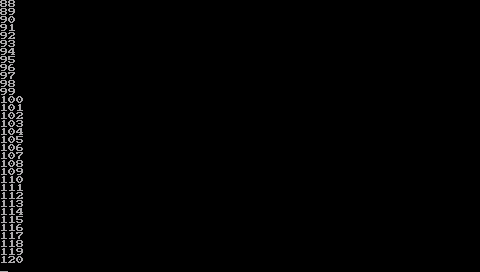

# LCD DMA 回卷与 Linux 滚屏实测

2026-10-11，480×272 RGB565、960 B stride，RV32IMA 60 MHz、DDR 120 MHz、4 KiB 共享 writeback L2。Linux 使用一帧 261120 B 环形缓冲，通过 YWRAP 改变扫描起点。

候选 bitstream：`463f6c5785807a334bddc3c1664c6090a16e30f83221130632c1c1a63790772d`；kernel：`2bc278b87e27870cd7e72c72b755ebea339fa50cdb65a66b05329f8ceb451ece`；bootstrap：`f888e59e9a55cbc35354aa0d6ce66014b1cf15748c65d2e19298b854b20e42d9`。基线 kernel 为 `1012dbee363ed5a5b48d6411145c2a47d1f1e8e76369c129206ed4d0be69ae87`，bitstream 为 `9f9f56ce7d01e99a2df0af9cc428c46a4515a3a384f1852eb0066b29c67c168e`。同一 BusyBox initrd，SHA256 `ee3d59c3cadf7b565930d7984503180b9a11baaffdf4bcea4acbf4d6ee33dada`。

## 性能

每项输出 120 行，用 /proc/uptime 前后值计时。测量脚本暂停 LCD top 并在结束后恢复；本组测量没有运行中的 top。基线一次，候选两次；样本较少，不外推到所有终端工作量。

| 路径 | 基线 | 回卷第 1 轮 | 回卷第 2 轮 |
| --- | ---: | ---: | ---: |
| seq 到 /dev/null | 3.01 s | 3.23 s | 2.84 s |
| seq 到 /dev/tty1 | 21.53 s | 8.96 s | 8.79 s |
| script 的 PTY 到 /dev/null | 7.89 s | 8.48 s | 7.10 s |

LCD 同负载约快 2.4 倍；5 秒阈值仍失败，原始失败日志保留。PTY 本身没有得到明确改善。先前高虚拟画布 pan 候选被用户报告为大部分空白、末列不可读，已淘汰，不能作为通过样本。

## 内容与 DMA

跨多次回卷后的逻辑终端内容连续为 88–120。首次像素回读时 yoffset=88，DMA base=0x00d94a00=0x00d80000+88×960，underflows/address_error=0。完整 261120 B 经 Ethernet 回读，按起点重建可见以下图像。第二轮 yoffset=232、base=0x00db6600，错误计数仍为 0。

这是帧缓冲像素与地址路径验证，物理 LCD 信号/屏幕尚未现场目视确认。Linux native fb0 mmap/readback/DMA/blank、BusyBox/PTY 和 USB HID 键盘枚举通过，operation 分别为 `20261011T032009556797Z-linux`、`20261011T032213138633Z-linux`。PnR setup/hold 0/0；44 组固件检查和 60 秒 soak/mic 通过。完整原始数据及 SHA256 见同名 JSON；镜像和 UART 原始收据保存在提交快照。
